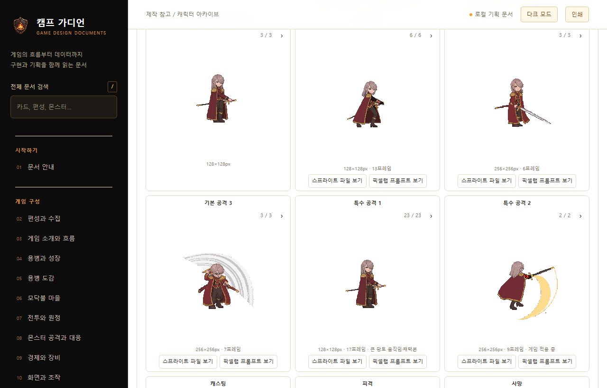

## 작업 결과

## 변경 내용

### 적용 내용

현재 선택 자동 스크롤과 게임 적용 배지. 프로젝트 1b567ec6 푸시.

## 검증

브라우저에서 23개 오름차순, 23번과 18번 재진입 포커스, 게임 적용 배지 확인.

## 남은 사항

중앙 배포 미확인.

## 작업 시간

- 제안 시간: 2~4분
- 실제로 완료된 시간: 약 1분 33초, 05:37:54 KST 프로젝트 푸시.
- XERJ: 미사용 — 웹 빌드 및 수정한 PNG
