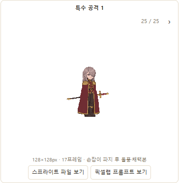

## 작업 결과

## 변경 내용

### 적용 내용

기록되지 않았습니다.

## 검증

문서 빌드 및 Chrome에서 GIF 로드, 25 / 25 기본 표시와 이전 시안 등록 확인.

## 남은 사항

웹 배포 상태 미확인.

## 작업 시간

- 제안 시간: 2~5분
- 실제로 완료된 시간: 약 2분, KST
- XERJ: 미사용 — 코드 검색 근거가 제공되지 않았습니다.
