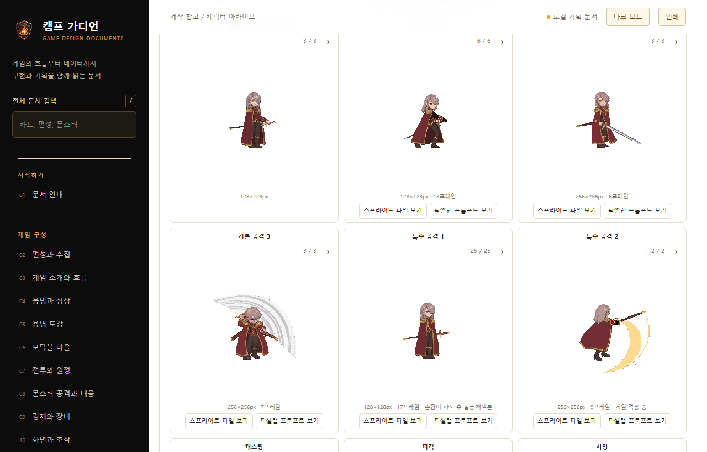
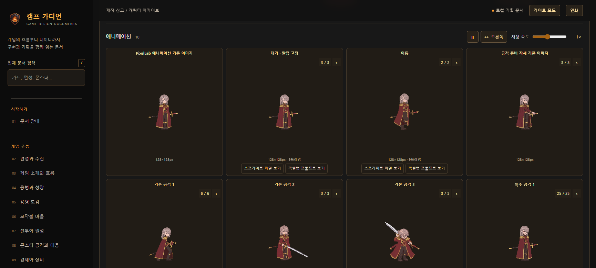

## 작업 결과

## 변경 내용

### 적용 내용

카드 중첩 그리드 해제와 현재 선택 강조. 프로젝트 0db74dcf 푸시.

## 검증

브라우저에서 미리보기 네 개 중심 높이와 25개 버전 중 18번 재진입 표시 확인.

## 남은 사항

중앙 배포 미확인.

## 작업 시간

- 제안 시간: 2~4분
- 실제로 완료된 시간: 약 1분 20초, 05:45:48 KST 프로젝트 푸시.
- XERJ: 미사용 — 웹 빌드 및 수정한 PNG
