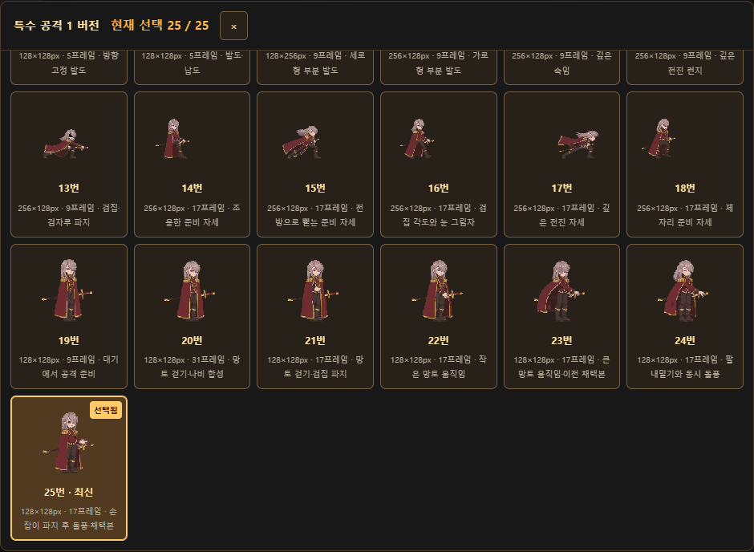

## 작업 결과

## 변경 내용

### 적용 내용

다크 모드 전용 스타일. 프로젝트 1dd37212 푸시.

## 검증

문서 빌드 및 Chrome 다크 모드 모달에서 선택 배지와 색상 확인.

## 남은 사항

중앙 배포 미확인.

## 작업 시간

- 제안 시간: 2~4분
- 실제로 완료된 시간: 약 40초, 05:47:39 KST 프로젝트 푸시.
- XERJ: 미사용 — 웹 빌드 및 수정한 PNG
