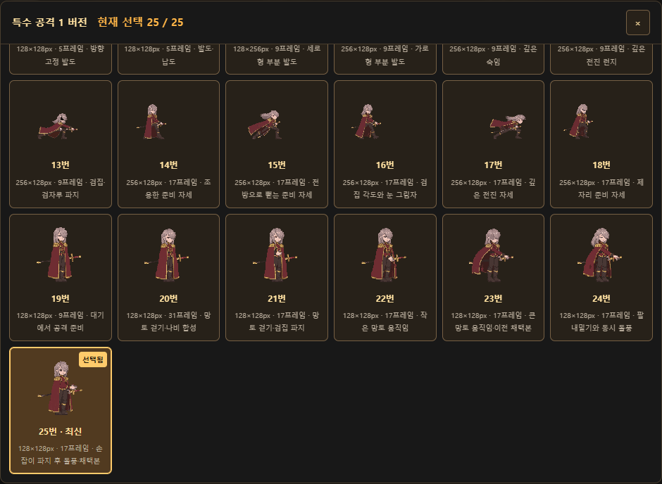

## 작업 결과

## 변경 내용

### 적용 내용

헤더 정렬. 프로젝트 ec79dd06 푸시.

## 검증

문서 빌드와 Chrome의 실제 닫기 버튼 우측 정렬 확인.

## 남은 사항

중앙 배포 미확인.

## 작업 시간

- 제안 시간: 2~3분
- 실제로 완료된 시간: 약 34초, 05:49:13 KST 프로젝트 푸시.
- XERJ: 미사용 — 웹 빌드 및 수정한 PNG
