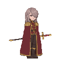

## 작업 결과

## 변경 내용

### 적용 내용

기록되지 않았습니다.

## 검증

128×128 시작 컷 포함 17프레임. 파지 후 돌풍 표현. 후반에 전신이 어두워지고 초반 검집 각도가 변합니다. 2회 사용, 1670/2000회 남음.

## 남은 사항

국소 눈가 그림자와 검집 각도 고정 미충족. 아카이브 미채택.

## 작업 시간

- 제안 시간: 2~5분
- 실제로 완료된 시간: 약 1분 50초, 06:03 KST 확인
- XERJ: 미사용 — 코드 검색 근거가 제공되지 않았습니다.
