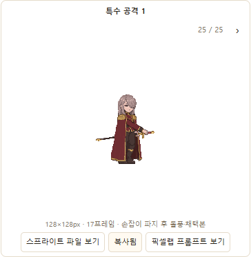

## 작업 결과

## 변경 내용

### 적용 내용

기록되지 않았습니다.

## 검증

PNG 2176×128, 원본 프레임 픽셀과 일치. Chrome에서 복사 버튼의 절대 경로와 파일 보기 링크 확인.

## 남은 사항

웹 게시 미확인.

## 작업 시간

- 제안 시간: 1~3분
- 실제로 완료된 시간: 약 1분, KST
- XERJ: 미사용 — 코드 검색 근거가 제공되지 않았습니다.
