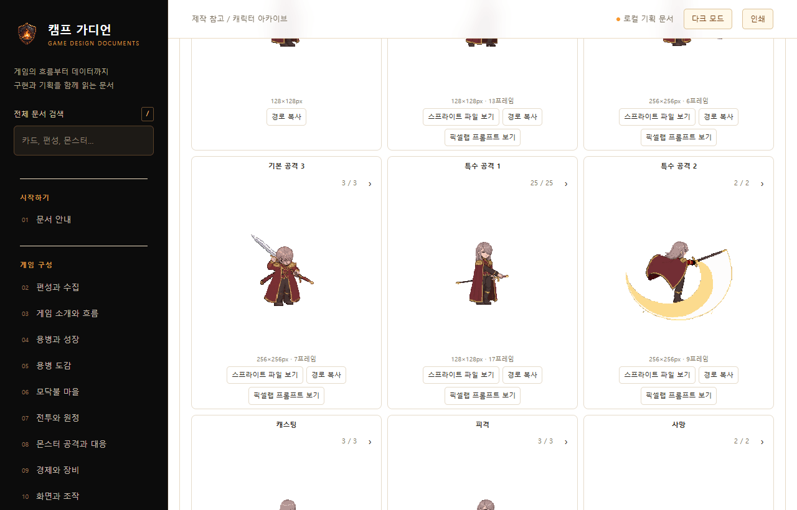

## 작업 결과

## 변경 내용

### 적용 내용

슬롯 표기와 제작 가이드 갱신. 프로젝트 dfb861c1 푸시.

## 검증

브라우저에서 특수 공격 1·2 슬롯 표기와 팝업 상세 및 게임 적용 배지를 확인했습니다.

## 남은 사항

중앙 배포 미확인.

## 작업 시간

- 제안 시간: 3~5분
- 실제로 완료된 시간: 약 1분 6초, 06:25:55 KST 프로젝트 푸시.
- XERJ: 미사용 — 웹 빌드 및 수정한 PNG
