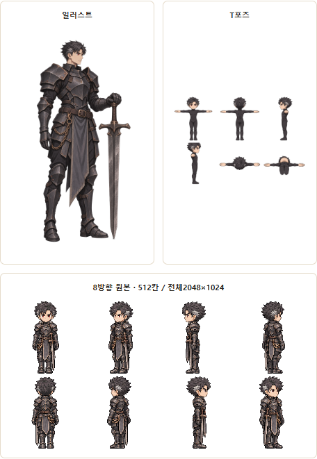

## 작업 결과

## 변경 내용

### 적용 내용

기록되지 않았습니다.

## 검증

2048×1024 및 정확한 3쌍 반전, 실제 아카이브 표시, 마네킹 겹침 확인. PixelLab 미사용.

## 남은 사항

8방향 무릎 높이와 발 벌림 차이, 별도 장비·몸체 정렬 최종 승인 대기.

## 작업 시간

- 제안 시간: 캐릭터별 진행
- 실제로 완료된 시간: 약 5분, 06:34 KST
- XERJ: 미사용 — 코드 검색 근거가 제공되지 않았습니다.
