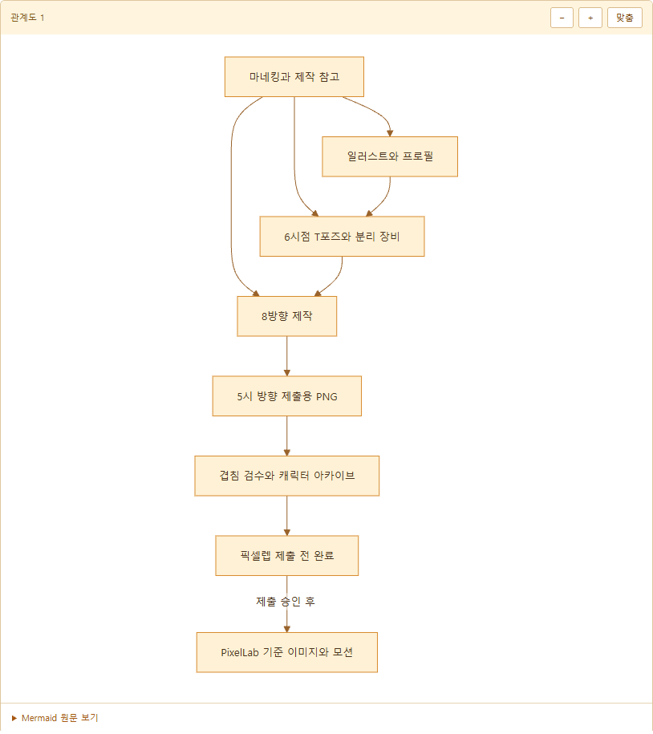

## 작업 결과

## 변경 내용

### 적용 내용

기록되지 않았습니다.

## 검증

Chrome에서 관계도 노드 8개, 단계 링크 6개와 참고 이미지 15개 로드 확인.

## 남은 사항

나머지 용병 개별 제작 및 검수. 웹 배포 미확인.

## 작업 시간

- 제안 시간: 약 3분
- 실제로 완료된 시간: 약 3분, KST
- XERJ: 미사용 — 코드 검색 근거가 제공되지 않았습니다.
