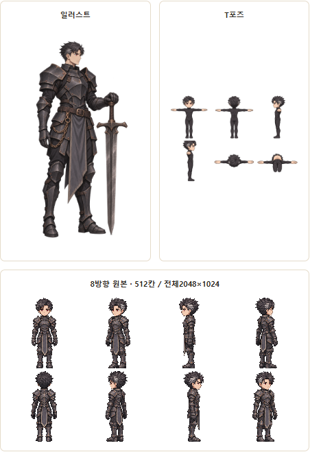

## 작업 결과

## 변경 내용

### 적용 내용

기록되지 않았습니다.

## 검증

2048×1024, 8칸과 정확한 3쌍 반전 확인. Chrome에서 무기 없는 방향 시트 로드. PixelLab 미사용.

## 남은 사항

마네킹 관절 정렬과 5시 제출용 합성 최종 검수 대기.

## 작업 시간

- 제안 시간: 캐릭터별 진행
- 실제로 완료된 시간: 06:44 KST 브라우저 확인
- XERJ: 미사용 — 코드 검색 근거가 제공되지 않았습니다.
