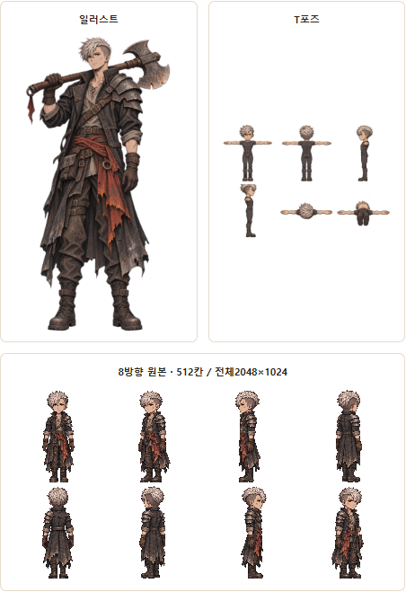

## 작업 결과

## 변경 내용

### 적용 내용

기록되지 않았습니다.

## 검증

방향당 512×512 및 정확한 좌우 반전, 아카이브의 주요 이미지 세 장 확인. PixelLab 미사용.

## 남은 사항

마네킹 관절 겹침 및 필요한 무기 합성을 포함한 제출용 PNG 최종 검수 대기.

## 작업 시간

- 제안 시간: 캐릭터별 진행
- 실제로 완료된 시간: 약 3분, 06:58 KST
- XERJ: 미사용 — 코드 검색 근거가 제공되지 않았습니다.
