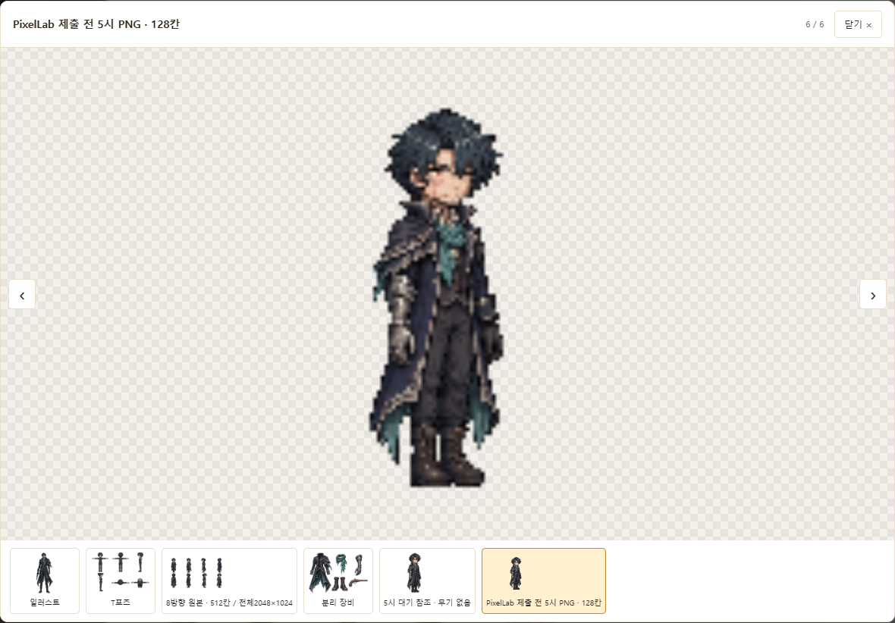

## 작업 결과

## 변경 내용

### 적용 내용

기록되지 않았습니다.

## 검증

Chrome에서 용병 7명의 제출 전 이미지 링크와 128×128 PNG 로드 확인. 캐릭터 높이 102px와 마네킹 발 기준을 적용했습니다.

## 남은 사항

마네킹 관절의 시점별 정밀 일치와 무기 가능 합성은 최종 검수 대기. PixelLab 호출 없음.

## 작업 시간

- 제안 시간: 캐릭터별 진행
- 실제로 완료된 시간: 07:02 KST 검수, 전체 약 35분
- XERJ: 미사용 — 코드 검색 근거가 제공되지 않았습니다.
