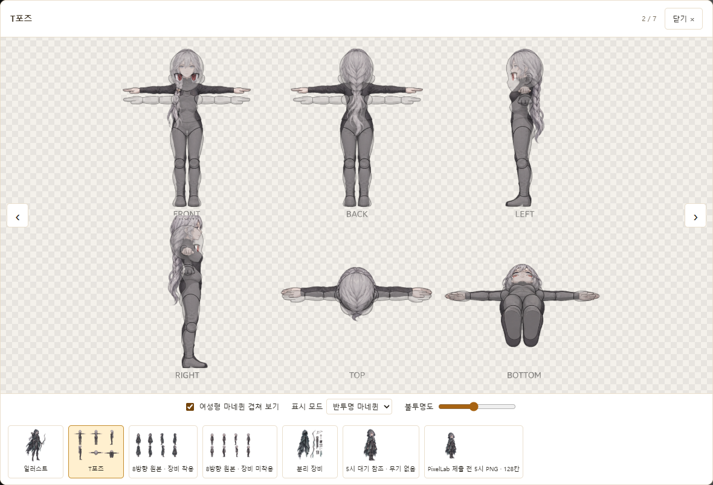
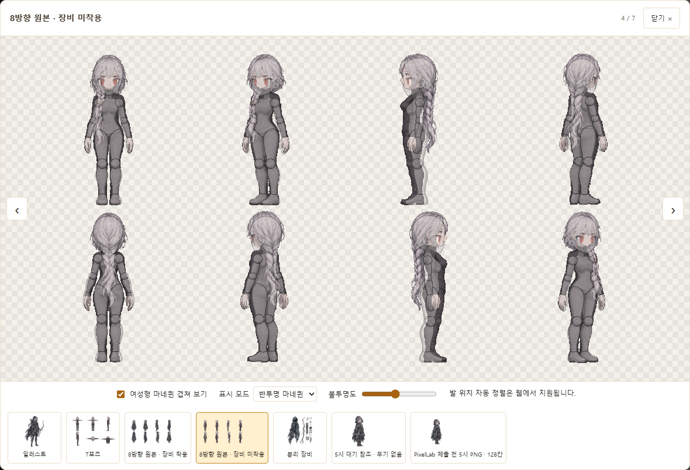
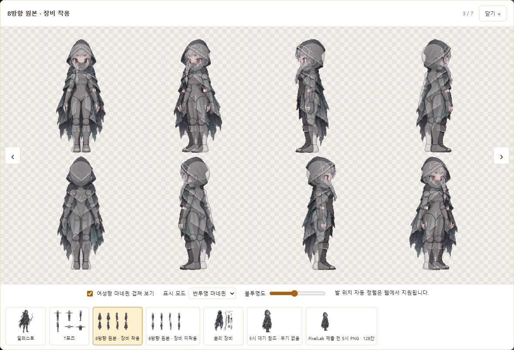

## 작업 결과

## 변경 내용

### 적용 내용

기록되지 않았습니다.

## 검증

Chrome에서 7명 각각 T포즈 및 착용·미착용 8방향 겹침을 켜 21곳 확인. 신규 시트 2048×1024 및 정확한 반전 세 쌍 확인.

## 남은 사항

최종 관절 일치 검수 및 웹 배포 미확인. PixelLab 호출 없음.

## 작업 시간

- 제안 시간: 5~8분
- 실제로 완료된 시간: 약 6분, 12:48 KST
- XERJ: 미사용 — 코드 검색 근거가 제공되지 않았습니다.
