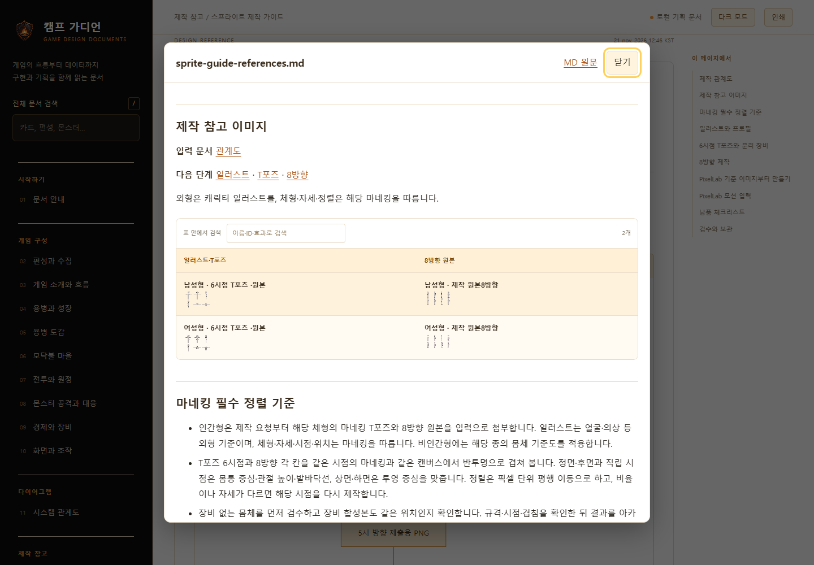

## 작업 결과

스프라이트 제작 가이드의 6개 단계 문서 팝업을 구현하고 프로젝트 main에 푸시했습니다.

## 변경 내용

### 적용 내용

기존 Mermaid 제작 순서에 파일명 링크를 연결했습니다. 기존 Markdown 렌더러가 단계별 문서 원본을 빌드 시 팝업에 넣습니다. 팝업에서 원문을 열 수 있습니다.

## 검증

Chrome에서 관계도 노드 6개를 눌러 실제 본문 표시와 MD 원문 경로를 확인했습니다. Enter, Escape, 닫기 버튼, 목록 링크와 포커스 복귀를 확인했습니다. 브라우저 스크립트 오류는 없었습니다. 프로젝트 푸시 최종 커밋 553de3a1.

## 남은 사항

모바일과 공개 페이지 배포 상태는 이 검수에서 미확인입니다.

## 작업 시간

- 제안 시간: 2026-11-21 12:43:48 KST 시작, 약 10분 예상.
- 실제로 완료된 시간: 구현·로컬 검수·프로젝트 푸시를 12:47:56 KST에 완료했습니다. 약 4분 소요.
- XERJ: 미사용 — 기존 문서 빌더 및 Chrome으로 확인했습니다. 중앙 업데이트 2026-11-21-011 원격 확인.
