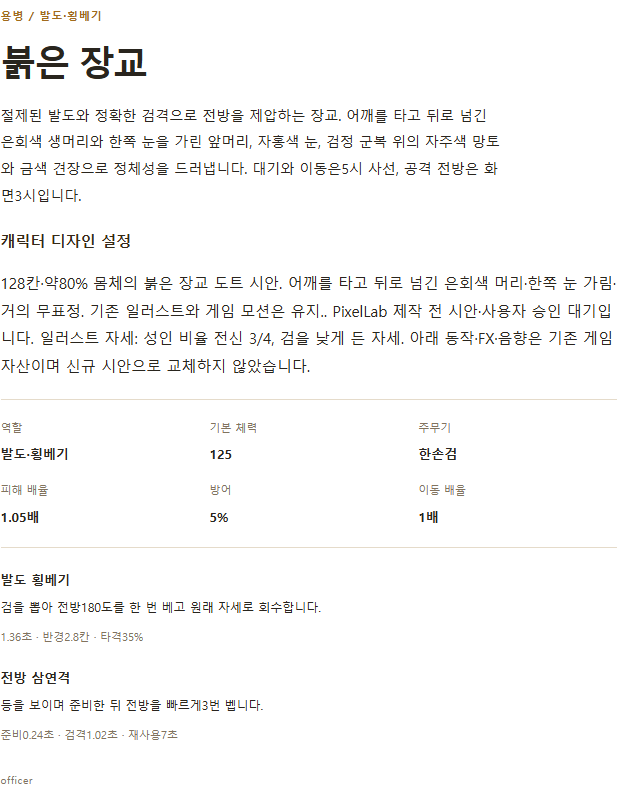

## 작업 결과

## 변경 내용

### 적용 내용

기록되지 않았습니다.

## 검증

Chrome에서 붉은 장교 역할 라벨 표시 및 아카이브 전체 클래스 문자열 미노출 확인.

## 남은 사항

웹 배포 미확인.

## 작업 시간

- 제안 시간: 1~2분
- 실제로 완료된 시간: 약 1분, KST
- XERJ: 미사용 — 코드 검색 근거가 제공되지 않았습니다.
