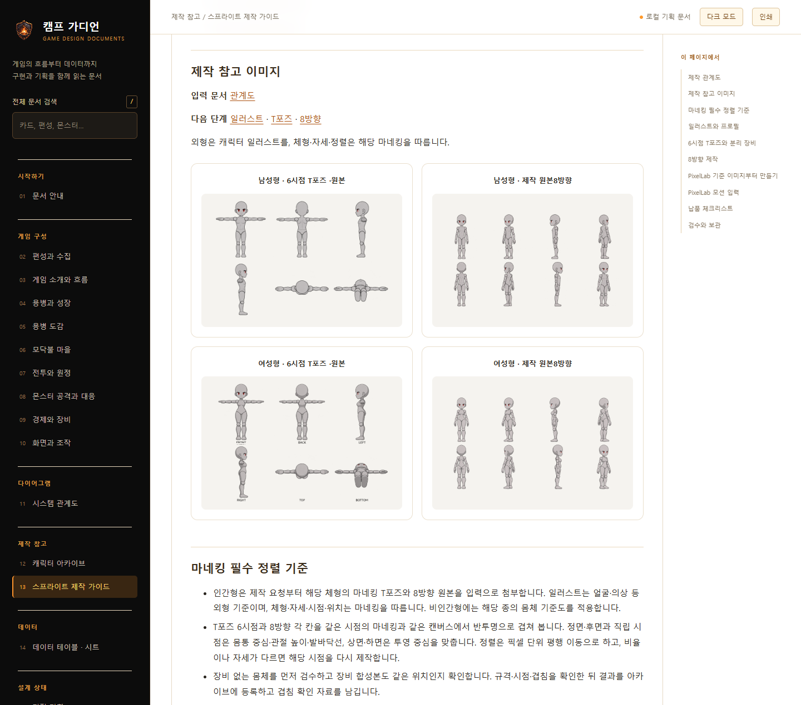

## 작업 결과

붉은 장교 참조 0건, 남녀 마네킹 기준 이미지 4장 표시

## 변경 내용

### 적용 내용

일러스트, T포즈와 분리 장비, 8방향, PixelLab 예시를 제거했습니다. 가이드 수정 범위는 문서 표시입니다.

## 검증

웹 빌드 성공. Chrome에서 가이드 이미지 4장을 디코드하고 본문과 팝업 원본에서 장교 참조가 없는 것을 확인했습니다. 프로젝트 main 푸시 성공.

## 남은 사항

웹 공개 배포와 중앙 게시 HTTPS 확인은 미확인입니다. 업데이트 게시판 원격 확인에 실패했습니다. 로컬 기록은 2026-11-21-011입니다.

## 작업 시간

- 제안 시간: 2026-11-21 12:45 KST 시작, 5분 예상
- 실제로 완료된 시간: 12:49 KST 작업 및 프로젝트 푸시 완료, 약 4분
- XERJ: 미사용 — 기존 Playwright로 웹 화면 확인
