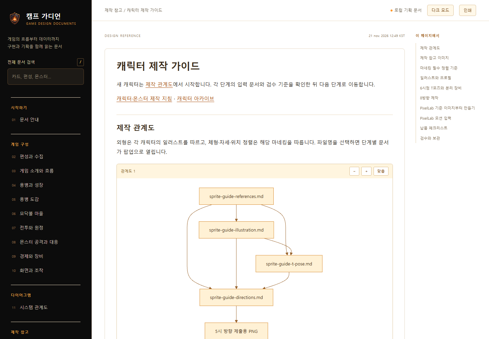

## 작업 결과

가이드 제목을 캐릭터 제작 가이드로 변경하고 프로젝트 main에 푸시했습니다.

## 변경 내용

### 적용 내용

Markdown 원본, 문서 빌드의 제목 정의, 홈 링크와 몬스터 공격 문서의 참조 이름, 생성 HTML을 함께 바꿨습니다. 기존 #sprite-guide 경로를 사용합니다.

## 검증

Chrome에서 본문 제목, 사이드 메뉴, 브라우저 탭 제목과 기존 제작 관계도의 렌더링을 확인했습니다. 프로젝트 커밋 64aa4034.

## 남은 사항

공개 페이지 반영은 미확인입니다.

## 작업 시간

- 제안 시간: 2026-11-21 12:50:29 KST 시작, 약 3분 예상.
- 실제로 완료된 시간: 구현·로컬 검수·프로젝트 푸시를 12:51:29 KST에 완료했습니다. 약 1분 소요.
- XERJ: 미사용 — Chrome으로 로컬 문서를 확인했습니다. 중앙 업데이트 2026-11-21-011을 원격 조회했습니다.
