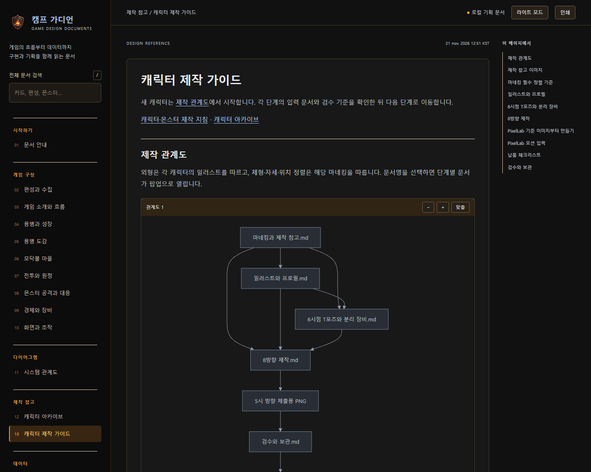
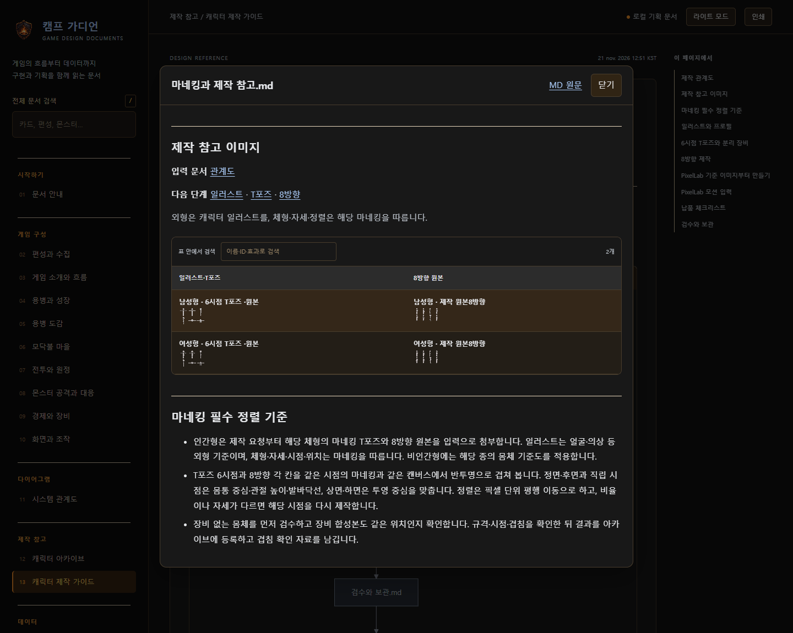

## 작업 결과

한글 .md 제목과 어두운 관계도, 밝은 회색 본문, 옅은 파란색 링크를 구현하고 프로젝트 main에 푸시했습니다.

## 변경 내용

### 적용 내용

문서 목록, 관계도 노드, 팝업에 동일한 한글 표시명을 적용했습니다. 팝업의 MD 원문은 기존 파일로 연결합니다. 다크 모드에서 제목·본문·버튼·표 머리글을 밝은 회색으로, 일반 링크를 옅은 파란색으로 바꿨습니다.

## 검증

Chrome에서 6개 노드의 한글 제목과 팝업 일치, 본문 표시, 원문 경로, Escape 닫기, 다크 모드에서 글씨와 관계도 색상 및 라이트 모드 전환을 확인했습니다. 브라우저 스크립트 오류 없음. 프로젝트 커밋 41f0b6f4.

## 남은 사항

공개 페이지 반영 및 모바일 표시는 미확인입니다.

## 작업 시간

- 제안 시간: 2026-11-21 13:12:46 KST 시작, 약 5분 예상.
- 실제로 완료된 시간: 구현·로컬 검수·프로젝트 푸시를 13:15:03 KST에 완료했습니다. 약 2분 소요.
- XERJ: 미사용 — Chrome으로 로컬 문서를 확인했습니다. 중앙 업데이트 2026-11-21-011을 원격 조회했습니다.
