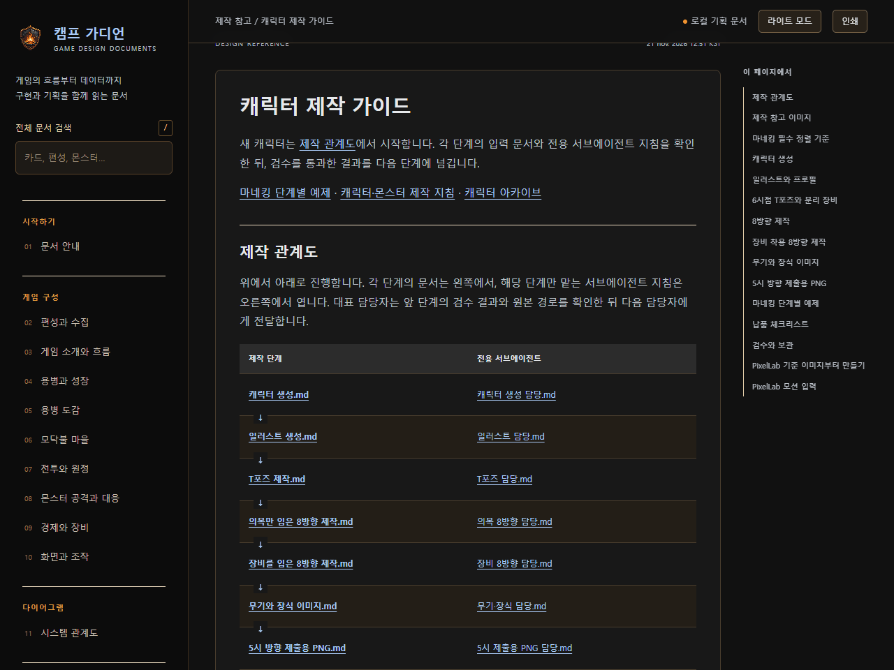
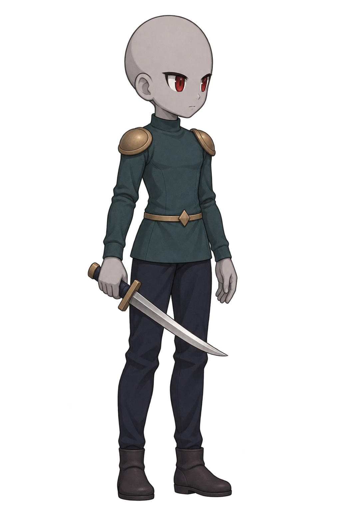
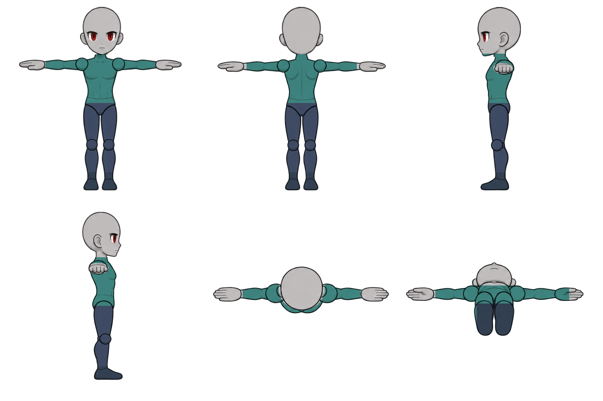
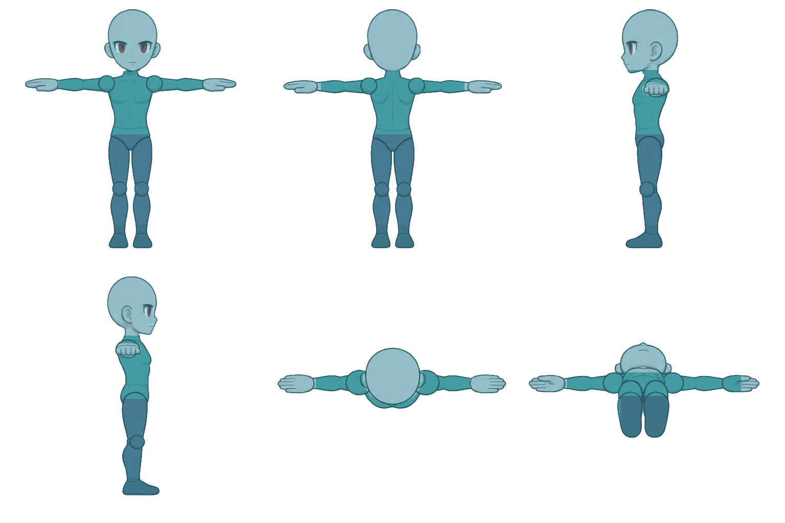
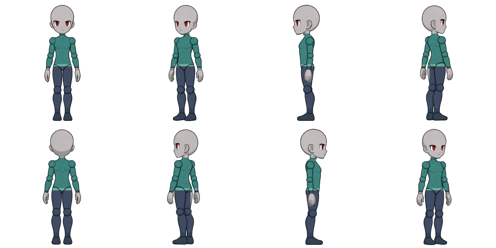
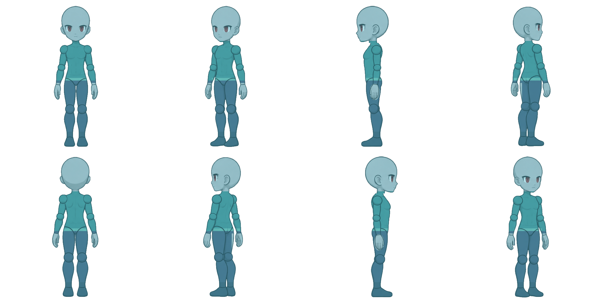
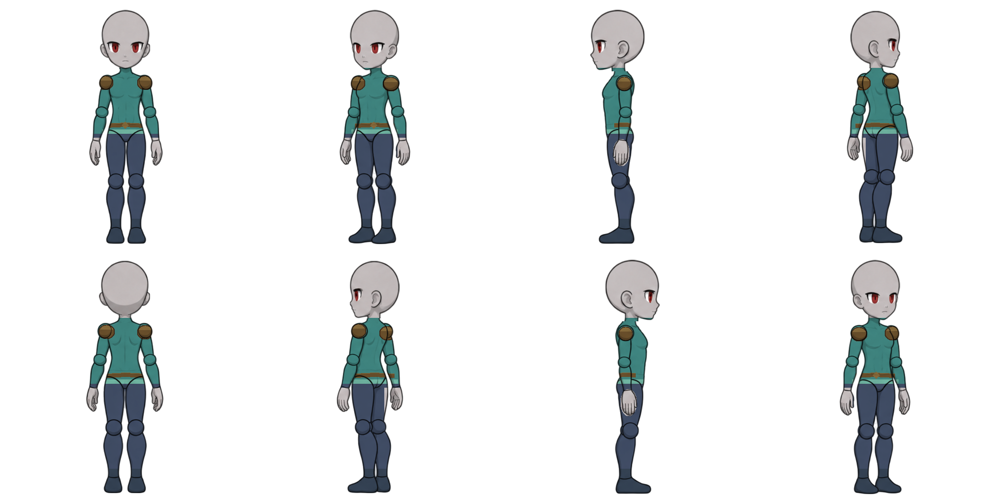
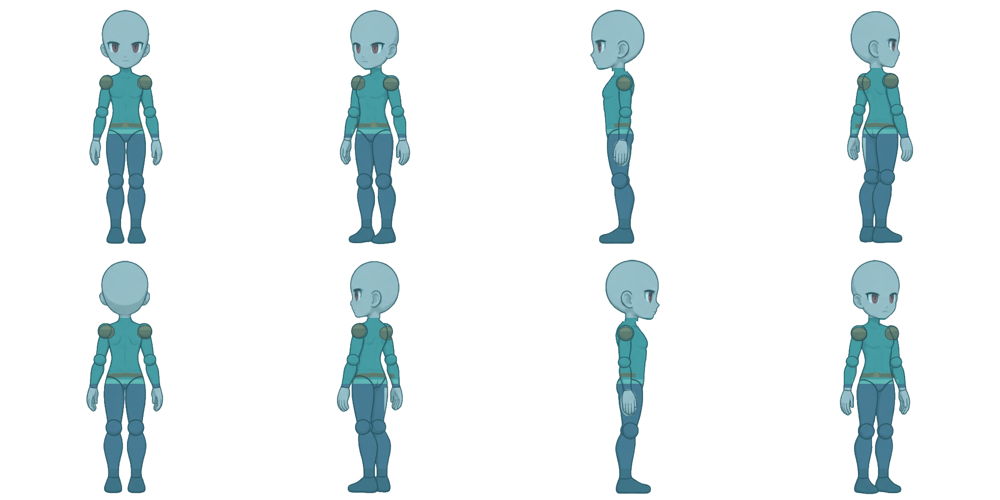
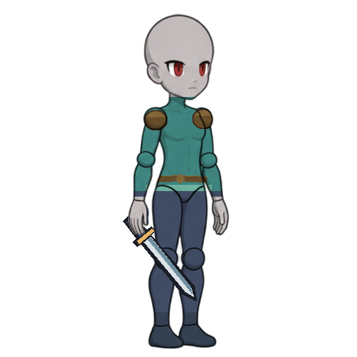
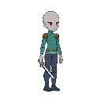

## 작업 결과

제작 문서·담당 지침 7쌍, 프로젝트 역할 TOML 7개, 동일 남성형 마네킹의 예제 PNG 11개를 프로젝트에 등록했습니다.

## 변경 내용

### 적용 내용

관계도 왼쪽에서 제작 단계, 오른쪽에서 전용 담당자 지침을 엽니다. 후속 담당자는 확정 입력·완성본·겹침 증거를 인계받습니다. 청동 훈련검 마네킹 한 체형으로 ImageGen 전신 일러스트와 원본 파생 예제, 분리 검과 버클, 5시 합성을 제작했습니다.

## 검증

Chrome에서 14개 팝업, 올바른 원문 경로, 예제 이미지 11개 디코딩과 확대, 모바일 관계도와 담당 팝업을 확인했습니다. 22개 시점 겹침과 8방향 시트별 3쌍의 반전을 검증했습니다. 128×128 후보의 몸체 높이는 102px입니다. TOML 7개를 파싱하고 단계와 역할 지침 경로를 대조했습니다. 프로젝트 커밋 144c1d8a.

## 남은 사항

새 Codex 세션에서 등록 역할 호출과 공개 페이지 반영은 미확인입니다. PixelLab 제출은 대기 상태입니다.

## 작업 시간

- 제안 시간: 2026-11-21 13:22:24 KST 시작, 현황 확인 후 약 8분 예상.
- 실제로 완료된 시간: 로컬 검수·프로젝트 main 푸시를 13:36:04 KST에 완료했습니다. 약 14분 소요.
- XERJ: 미사용 — 공식 Codex 문서와 프로젝트 브라우저, PNG 분석 기록을 확인했습니다. 중앙 업데이트 2026-11-21-011을 원격 조회했습니다.
