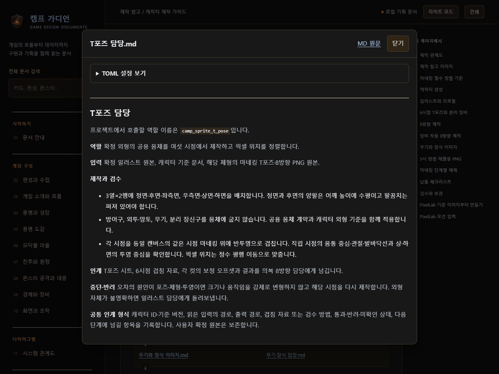

## 작업 결과

7개 담당 팝업에 실제 설정 내용과 원문 링크를 추가하고 관계도에 인계 문서 링크를 연결했습니다.

## 변경 내용

### 적용 내용

웹 빌드가 프로젝트에 등록된 각 TOML 원문을 읽어 접이식 설정 영역에 넣습니다. 제작 관계도 아래에는 인계 규칙과 마네킹 예제 링크를 배치했습니다.

## 검증

Chrome에서 일곱 팝업의 표시 설정이 실제 파일과 일치하고 가로 공간에 맞춰 줄바꿈되는 것을 확인했습니다. 인계 링크 두 개는 로컬에서 확인했습니다. 캡처는 실제 브라우저의 닫힌 설정과 펼친 설정 두 프레임입니다. 프로젝트 커밋 e2e1c845.

## 남은 사항

공개 페이지 반영과 GitHub 링크의 브라우저 접근 상태는 미확인입니다.

## 작업 시간

- 제안 시간: 2026-11-21 14:02:18 KST 시작, 약 5분 예상.
- 실제로 완료된 시간: 로컬 브라우저 검수와 프로젝트 푸시를 14:05:13 KST에 마쳤습니다. 약 3분 소요.
- XERJ: 미사용 — 웹 문서 빌드 및 Chrome 검수를 사용했습니다. 중앙 업데이트 2026-11-21-011을 원격 조회했습니다.
