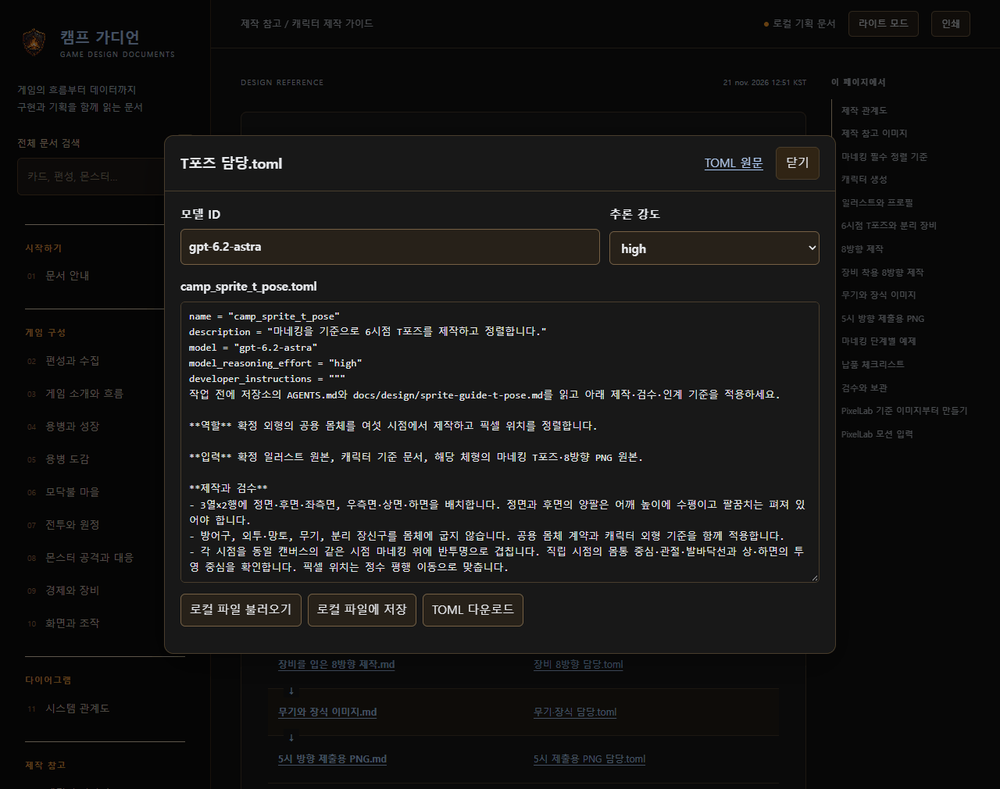

## 작업 결과

전용 에이전트 7개에 GPT-6.2 Astra와 high를 지정하고, 중복된 설명 문서의 역할 지침을 TOML로 이관했습니다.

## 변경 내용

### 적용 내용

역할 셀에서 TOML 편집기를 엽니다. 모델과 추론 강도 입력을 TOML 원문에 동기화합니다. 브라우저에서 선택한 같은 이름의 파일에 저장하거나 TOML을 다운로드할 수 있습니다.

## 검증

Chrome에서 기본값 7개와 원문 일치, 편집 동기화, 실제 다운로드 파일 내용을 확인했습니다. 파일 선택기 대신 테스트 핸들을 연결해 임시 파일 쓰기와 외부 변경 시 덮어쓰기 차단을 확인했습니다. 기존 역할 파일 7개는 TOML 구문을 확인했습니다. 프로젝트 커밋 c994451a.

## 남은 사항

브라우저 기본 파일 선택기에서 직접 저장하는 UI 절차와 공개 페이지 반영은 미확인입니다.

## 작업 시간

- 제안 시간: 2026-11-21 14:08:30 KST 시작, 약 7분 예상.
- 실제로 완료된 시간: 구현·브라우저 검수와 프로젝트 푸시를 14:12:49 KST에 마쳤습니다. 약 4분 20초 소요.
- XERJ: 미사용 — 웹 문서 빌드와 Chrome을 사용했습니다. 중앙 업데이트 2026-11-21-011을 원격 조회했습니다.
