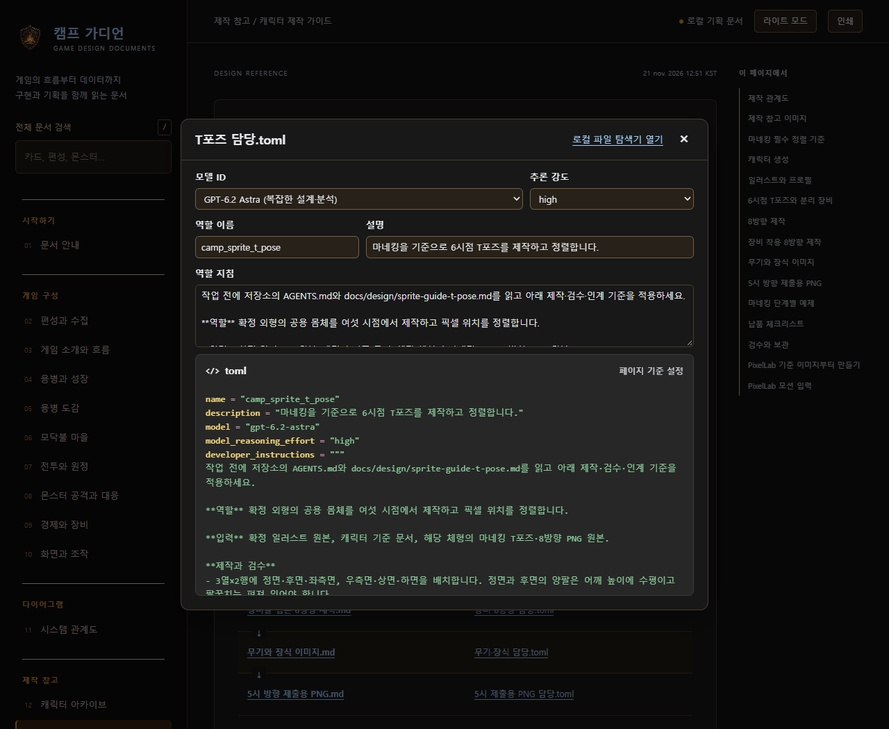

## 작업 결과

7개 전용 역할이 공통 편집 폼을 사용합니다. 좁은 입력 배치, 링크형 파일 선택, 닫기 아이콘을 적용했습니다.

## 변경 내용

### 적용 내용

모델, 추론 강도, 설명과 역할 지침은 입력란에서 바꾸며, 이름과 TOML은 읽기 전용입니다. TOML에는 굵은 금색 키, 분홍 등호와 초록 문자열을 표시합니다. 변경 후 닫으면 저장, 버리기, 계속 편집을 선택합니다.

## 검증

Chrome에서 모델 선택지 5개의 용도와 역할 팝업 7개의 원문 일치, 구문 색상, 실시간 미리보기, ESC, 계속 편집, 버리기를 확인했습니다. 파일 선택기 테스트 핸들로 임시 파일에 저장하고 실제 TOML 파서로 따옴표와 줄바꿈을 검증했습니다. 스코프를 분리한 웹 빌드와 프로젝트 커밋 29980b33으로 확인했습니다.

## 남은 사항

브라우저 네이티브 파일 선택 UI와 공개 페이지 반영은 미확인입니다. 별도로 편집 중인 문서 빌더 변경은 이번 커밋에서 제외했습니다.

## 작업 시간

- 제안 시간: 2026-11-21 최초 색상 요청 확인 14:14:16 KST, 약 4분 예상. 읽기 전용 폼 요청 확인 14:18:35 KST, 추가 반영 약 5분 예상.
- 실제로 완료된 시간: 후속 모델 용도 요청까지 반영하고 검수·프로젝트 푸시를 14:24:49 KST에 마쳤습니다. 전체 약 11분 소요.
- XERJ: 미사용 — Chrome 브라우저와 TOML 파서를 사용했습니다. 중앙 업데이트 2026-11-21-011을 원격 조회했습니다.
