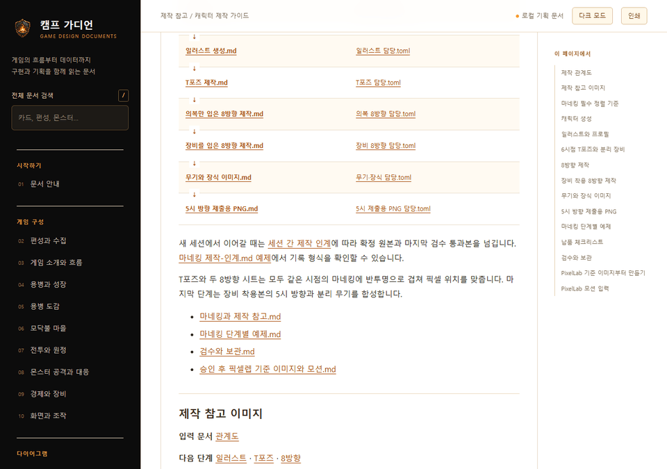

## 작업 결과

## 변경 내용

### 적용 내용

로컬 Markdown을 빌드에 포함하고 제목 링크 위치를 유지했습니다. 본문과 데이터 시트의 그림을 기존 갤러리 모달에서 확대하도록 연결했습니다. 프로젝트 main 327a0c12 원격 푸시 확인.

## 검증

헤드리스 Chrome에서 마네킹 제작 인계, 문서 내 제목 앵커, 문서 안 이미지, 로고, 몬스터 갤러리, 데이터 시트 Enter 확대 및 Escape로 닫기 확인. 문서 빌드 16페이지 완료.

## 남은 사항

공개 사이트 배포와 중앙 업데이트 원격 최신 상태 미확인. 로컬 최신 캐시 2026-11-21-011.

## 작업 시간

- 제안 시간: 8분
- 실제로 완료된 시간: 약 5분, 2026-11-21 14:26 KST 프로젝트 구현·검수·푸시 완료.
- XERJ: 미사용 — Chrome 실행과 실제 클릭 결과 GIF
