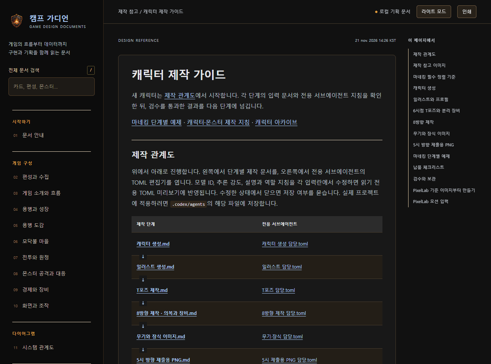

## 작업 결과

관계도는 6단계입니다. camp_sprite_directions가 의복본을 검수한 뒤 같은 몸체에 장비를 씌우고 두 시트를 함께 인계합니다.

## 변경 내용

### 적용 내용

단계 문서 두 개와 기존 역할 두 개를 합쳤습니다. 마네킹 겹침, 정확한 반전, 두 시트 개별 보관과 다음 담당자에게 SE 칸 인계를 유지합니다.

## 검증

웹 빌드와 Chrome에서 관계도 6행, 의복 및 장비 두 절, 통합 TOML 편집기와 원문 일치를 확인했습니다. 프로젝트 설정 6개를 TOML 파서로 검증했습니다. 프로젝트 커밋 c31d69e6.

## 남은 사항

새 세션에서 통합 역할을 호출해 실제 제작하는 절차와 공개 페이지 반영은 미확인입니다.

## 작업 시간

- 제안 시간: 2026-11-21 14:26:21 KST 시작, 약 5분 예상.
- 실제로 완료된 시간: 구현·로컬 검수·프로젝트 푸시를 14:29:01 KST에 마쳤습니다. 약 2분 40초 소요.
- XERJ: 미사용 — 웹 문서 빌드, Chrome, TOML 파서를 사용했습니다. 중앙 업데이트 2026-11-21-011을 원격 조회했습니다.
