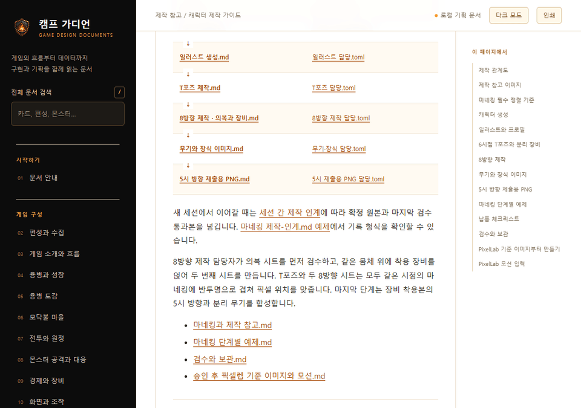

## 작업 결과

## 변경 내용

### 적용 내용

공통 dialog 배경에 blur(6px)를 적용하고 CSS 캐시 키를 갱신했습니다.

## 검증

Chrome에서 제작 인계 문서와 이미지 모달을 열어 6px 배경 블러와 모달 본문을 확인했습니다.

## 남은 사항

공개 배포 미확인.

## 작업 시간

- 제안 시간: 4분
- 실제로 완료된 시간: 약 2분, 2026-11-21 14:31 KST 브라우저 확인 및 보고 등록.
- XERJ: 미사용 — 로컬 Chrome에서 실제 조작을 기록한 GIF
