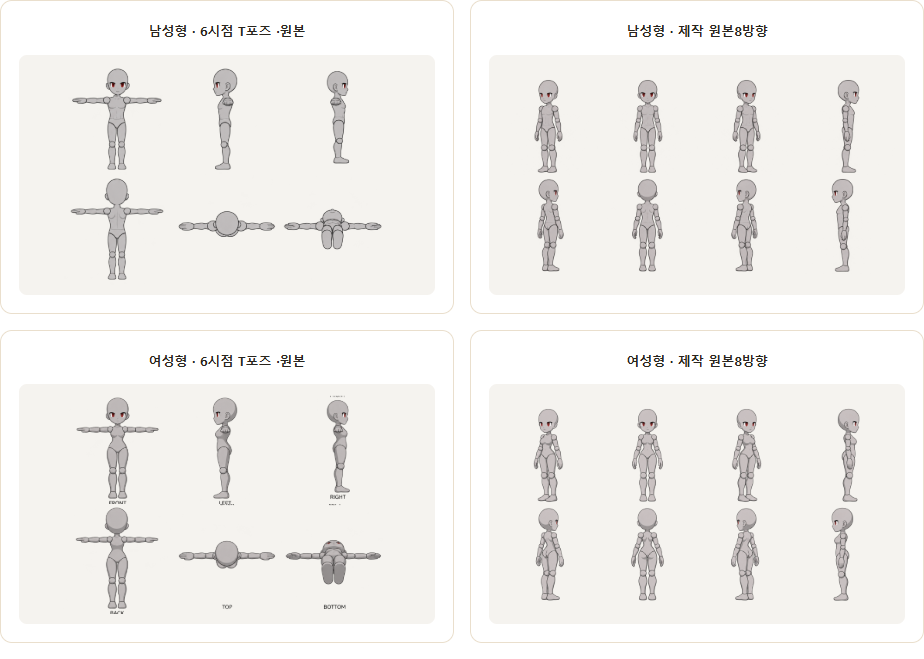
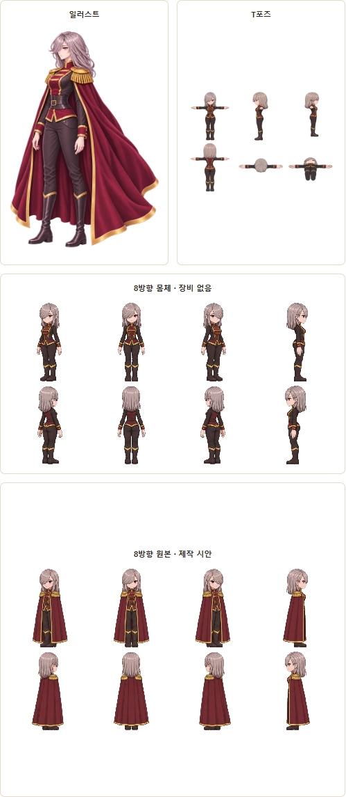

## 작업 결과

브라우저에서 표시 순서 변경을 확인했습니다. 프로젝트 main에 c4a983e5까지 푸시했습니다.

## 변경 내용

### 적용 내용

T포즈 위 정면·왼쪽·오른쪽, 아래 후면·위·아래. 8방향 위 SW·S·SE·E, 아래 NW·N·NE·W. 장교의 의복과 장비 착용 모두 적용. 제작 원본 보존. ImageGen 미사용.

## 검증

표시용 PNG 7장의 칸별 RGBA 픽셀 일치 확인. 로컬 docs/index.html에서 인라인과 확대 표시 및 장교 겹쳐 보기 확인. 실제 브라우저 화면 2장 캡처.

## 남은 사항

프로젝트 공개 페이지 배포와 공개 화면은 미확인.

## 작업 시간

- 제안 시간: 5분
- 실제로 완료된 시간: 14:26:44 시작, 14:30:48 KST 기준 약 4분
- XERJ: 미사용 — 코드 검색 근거가 제공되지 않았습니다.
