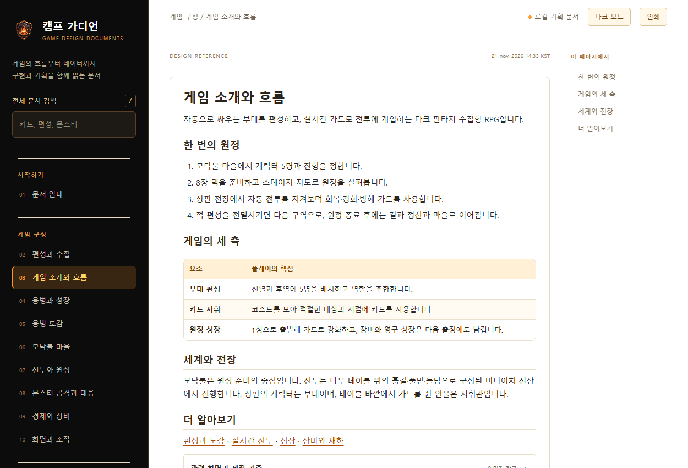
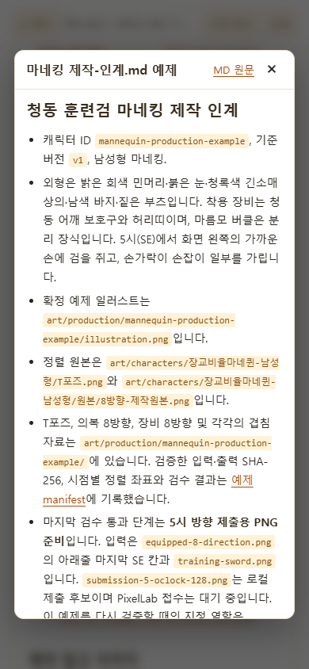

## 작업 결과

## 변경 내용

### 적용 내용

본문 14px, 문서 제목 24px, 중간 제목 18px. 게임 가이드 섹션 카드와 장식 번호 제거, 표와 목록 간격 축소, 모바일 모달 제목 20px 적용.

## 검증

16페이지 빌드. Chrome에서 데스크톱 문서와 390px 모바일 모달, 닫기 버튼 위치와 다크 모드 확인.

## 남은 사항

공개 배포 미확인.

## 작업 시간

- 제안 시간: 6분
- 실제로 완료된 시간: 약 3분, 2026-11-21 14:35 KST 브라우저 검수 및 보고 등록.
- XERJ: 미사용 — 로컬 Chrome 실제 화면 PNG 두 장
