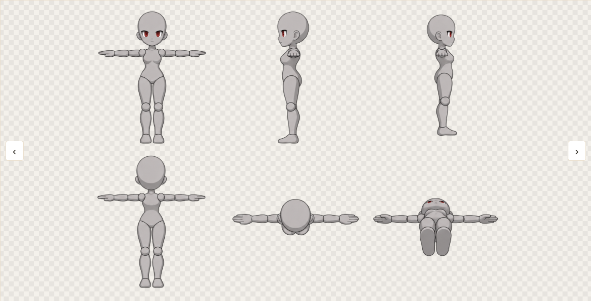

## 작업 결과

여성 마네킹 T포즈와 반투명 겹쳐 보기에서 방향 글씨를 제거했습니다. 프로젝트 main에 f13bad34를 푸시했습니다.

## 변경 내용

### 적용 내용

투명 영역의 방향 글씨만 지우고 제작 원본과 파일 경로를 보존했습니다. 아카이브, 가이드, 데이터 설명과 접근성 문구의 표기를 통일했습니다.

## 검증

로컬 Chromium에서 가이드, 확대 이미지, 장교 반투명 겹쳐 보기와 전체 문서의 표시 문구를 확인했습니다. ImageGen 미사용.

## 남은 사항

프로젝트 공개 페이지 배포와 공개 표시 미확인.

## 작업 시간

- 제안 시간: 5분
- 실제로 완료된 시간: 14:33:52 KST 시작, 프로젝트 푸시까지 약 2분 20초
- XERJ: 미사용 — 코드 검색 근거가 제공되지 않았습니다.
