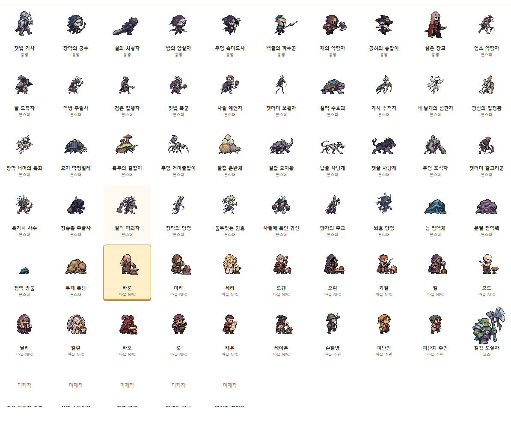

## 작업 결과

아카이브 93종에서 65종으로 정리했습니다.

## 변경 내용

### 적용 내용

아카이브 생성기와 게시용 HTML의 목록·상세·검색 항목을 수정했습니다. 게임 데이터와 아트 원본은 보존했습니다. 프로젝트 main 푸시 81c8f8cd.

## 검증

문서 빌드 성공. 실제 로컬 문서를 Chrome으로 열어 카드 65종과 바론 상세 표시를 확인하고 화면을 캡처했습니다.

## 남은 사항

공개 사이트 배포 미확인.

## 작업 시간

- 제안 시간: 약 5분
- 실제로 완료된 시간: 2026-11-21 14:35~14:38 KST, 약 3분
- XERJ: 미사용 — Playwright Chrome으로 로컬 HTML 확인 및 화면 캡처.
