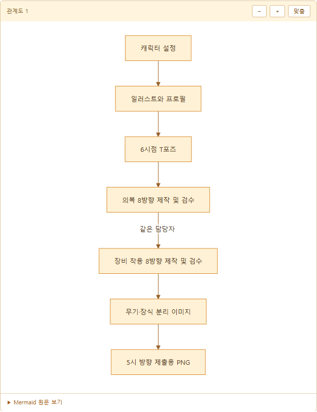

## 작업 결과

## 변경 내용

### 적용 내용

기존 Mermaid 렌더러를 재사용해 일곱 노드와 같은 담당자의 8방향 의복·장비 제작 순서를 표시했습니다. 기존 Markdown 및 TOML 편집 링크도 유지했습니다.

## 검증

16페이지 빌드, Mermaid 다이어그램 5개. Chrome에서 새 관계도의 노드 7개 및 연결 6개 순서와 기존 문서·TOML 모달을 확인했습니다.

## 남은 사항

공개 배포 미확인.

## 작업 시간

- 제안 시간: 5분
- 실제로 완료된 시간: 약 2분, 2026-11-21 14:38 KST 브라우저 검수 및 보고 등록.
- XERJ: 미사용 — Chrome에서 렌더링한 관계도 실제 화면
