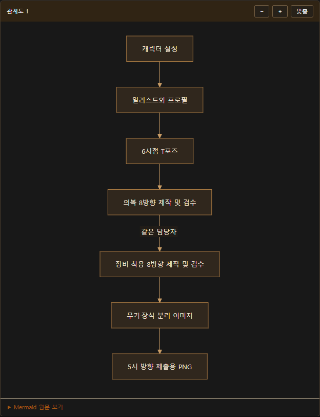

## 작업 결과

## 변경 내용

### 적용 내용

다크 모드 CSS로 관계도 패널, SVG 배경, 노드, 레이블과 화살표 색상을 적용했습니다.

## 검증

Chrome에서 다크·라이트 모드 전환, 노드와 글자 색상, SVG 크기 일치 확인.

## 남은 사항

공개 배포 미확인.

## 작업 시간

- 제안 시간: 4분
- 실제로 완료된 시간: 약 2분, 2026-11-21 14:43 KST 브라우저 검수 및 보고 등록.
- XERJ: 미사용 — Chrome 렌더링 스크린샷
