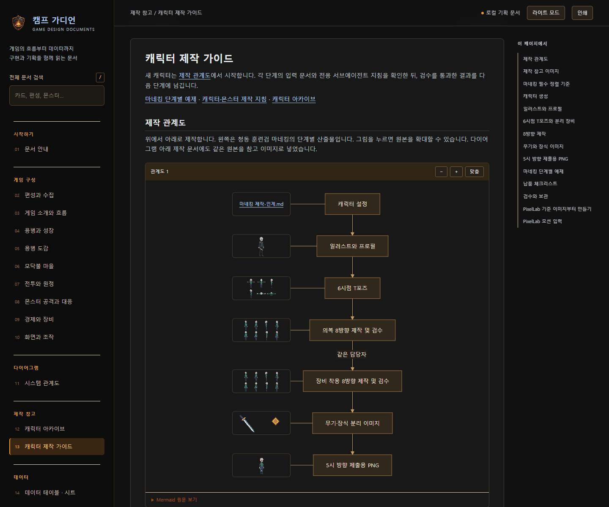

## 작업 결과

일곱 노드에 인계 문서와 PNG 썸네일을 배치했습니다. 단계별 Markdown은 원본 예제 및 겹침 자료를 포함합니다.

## 변경 내용

### 적용 내용

처음 구현에서 관계도를 표로 변경했으나 사용자 정정에 따라 기존 Mermaid 흐름을 복원하고 각 노드에 연결선을 붙였습니다. 가이드의 담당 문서 표는 별도로 유지했습니다.

## 검증

Chrome에서 원래 노드 7개와 진행 화살표 6개, 왼쪽 미리보기 7개와 연결선, 노드 중심 정렬, 확대·맞춤, 이미지 확대와 인계 문서 열기, 모바일 390px 표시를 확인했습니다. 단계 문서 팝업에서 예제와 겹침 이미지 11개를 디코딩했습니다. 프로젝트 최종 커밋 99bf45e5.

## 남은 사항

공개 페이지 반영은 미확인입니다. 실제 캐릭터 제작이나 PixelLab 접수는 이번 웹 가이드 변경 범위에 포함되지 않았습니다.

## 작업 시간

- 제안 시간: 2026-11-21 14:43:26 KST 최초 시작, 약 6분 예상. 구조 정정 14:48:02 KST 시작, 약 5분 예상.
- 실제로 완료된 시간: 브라우저 검수 및 프로젝트 푸시 14:50:50 KST 완료. 정정 작업 약 3분, 최초 시작 기준 약 7분 24초.
- XERJ: 미사용 — 웹 문서 빌드 및 Chrome으로 확인했습니다. 중앙 업데이트 2026-11-21-011을 원격 조회했습니다.
