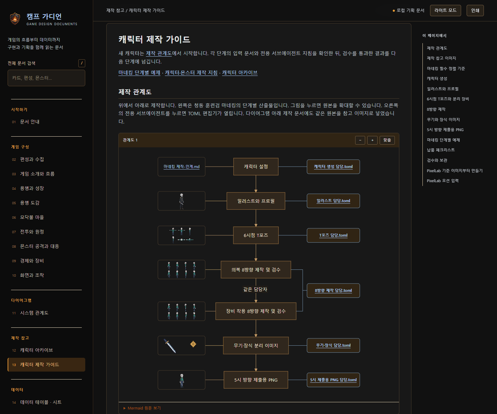

## 작업 결과

전용 역할 6개를 연결했습니다. 의복과 장비 8방향 노드는 하나의 역할 카드로 합류합니다.

## 변경 내용

### 적용 내용

왼쪽에 기존 산출물, 가운데 작업 순서, 오른쪽에 역할을 표시합니다. Markdown의 관계도 정의를 사용해 에이전트 연결선을 그립니다.

## 검증

Chrome에서 제작 노드 7개, 방향 화살표 6개, 양쪽 연결선 각 7개, 오른쪽 역할 6개, 8방향 공용 담당 1개를 확인했습니다. 모든 역할 카드에 연결된 TOML 편집기와 실제 설정 파일을 대조했습니다. 모바일 390px 폭에서 캔버스 맞춤과 오류 없음도 확인했습니다. 프로젝트 커밋 aa93e2fb.

## 남은 사항

공개 페이지 배포 상태는 미확인입니다.

## 작업 시간

- 제안 시간: 2026-11-21 14:52:44 KST 시작, 약 4분 예상.
- 실제로 완료된 시간: 로컬 검수와 프로젝트 푸시 14:54:28 KST 완료, 약 2분 소요.
- XERJ: 미사용 — 웹 문서 빌드와 Chrome으로 확인했습니다. 중앙 업데이트 2026-11-21-011을 원격 조회했습니다.
