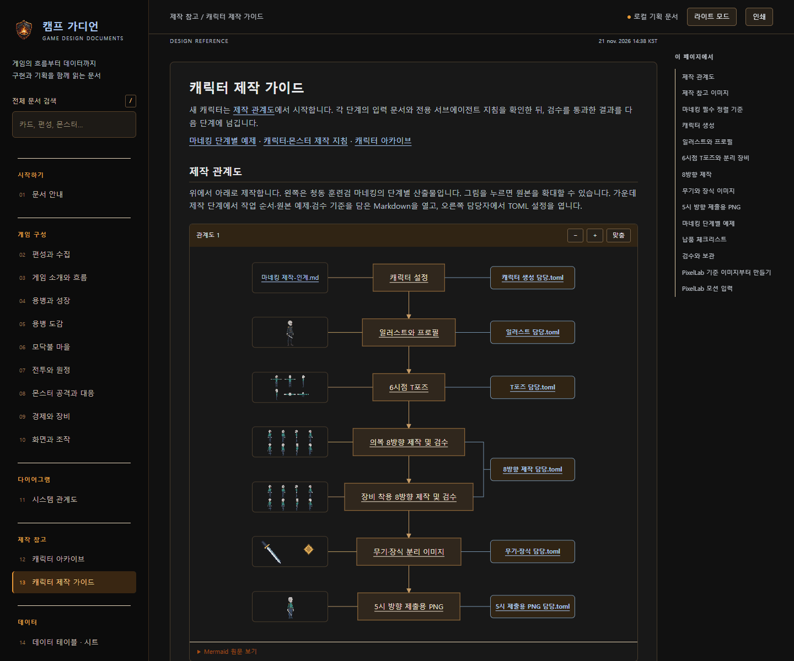

## 작업 결과

7개 노드에서 제작 문서를 열며 두 8방향 노드는 통합 문서의 각 절로 이동합니다.

## 변경 내용

### 적용 내용

가운데 노드에서 Markdown을, 오른쪽 담당자에서 TOML을 엽니다. 의복·장비 8방향은 오른쪽의 담당 카드 하나로 이어집니다.

## 검증

Chrome에서 제작 노드 7개와 진행 화살표 6개를 확인했습니다. 노드 7개가 정확한 문서 절을 열고, Enter와 Escape가 작동하며, 공용 8방향 TOML 카드 하나가 연결되는 것을 확인했습니다. 프로젝트 커밋 00ff9a1f.

## 남은 사항

공개 페이지 반영은 미확인입니다.

## 작업 시간

- 제안 시간: 2026-11-21 14:56:09 KST 시작, 약 4분 예상.
- 실제로 완료된 시간: 로컬 검수와 프로젝트 푸시 14:57:36 KST 완료, 약 1분 30초 소요.
- XERJ: 미사용 — 웹 문서 빌드와 Chrome으로 검수했습니다. 중앙 업데이트 2026-11-21-011을 원격 조회했습니다.
