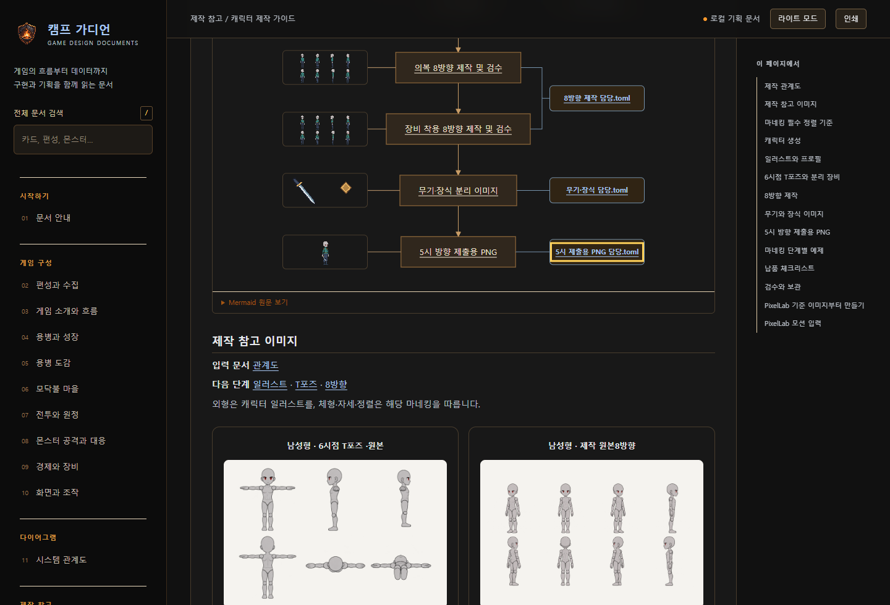

## 작업 결과

다이어그램에서 문서와 담당자 설정을 열 수 있고, 다음 본문 섹션은 제작 참고 이미지입니다.

## 변경 내용

### 적용 내용

중복 표와 안내 블록을 삭제하고 전용 렌더링·스타일을 제거했습니다.

## 검증

Chrome에서 다음 섹션이 제작 참고 이미지인지 확인하고, 다이어그램의 제작 문서 링크 7개와 TOML 링크 6개, 두 팝업 유형이 열린 것을 확인했습니다. 프로젝트 커밋 c4cc22ed.

## 남은 사항

공개 페이지 반영은 미확인입니다.

## 작업 시간

- 제안 시간: 2026-11-21 15:00:10 KST 시작, 약 3분 예상.
- 실제로 완료된 시간: 로컬 검수와 프로젝트 푸시를 15:01:13 KST에 마쳤습니다. 약 1분 소요.
- XERJ: 미사용 — 웹 문서 빌드와 Chrome으로 검수했습니다. 중앙 업데이트 2026-11-21-011을 원격 조회했습니다.
