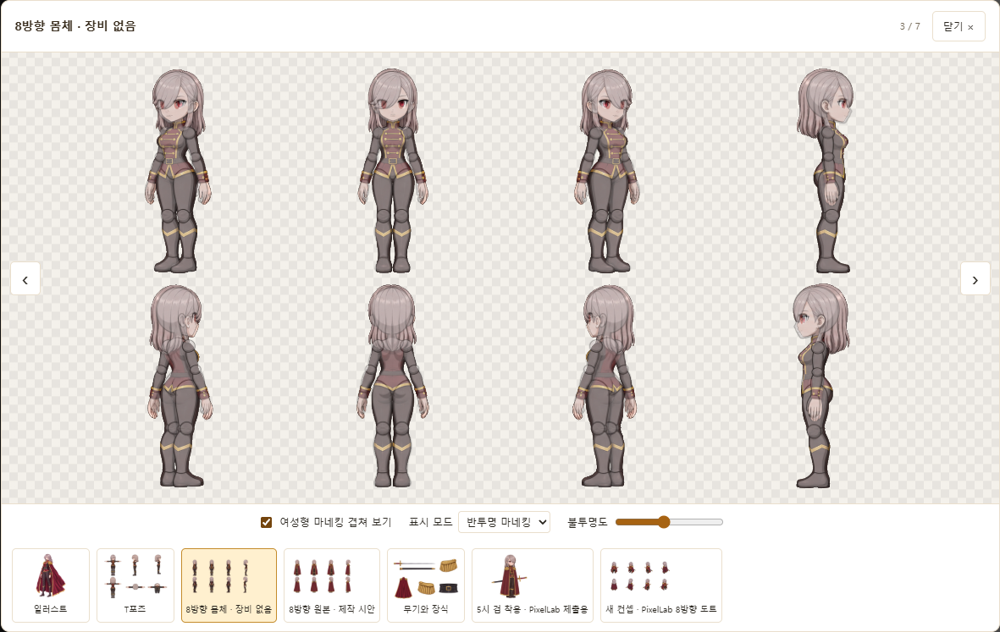

## 작업 결과

붉은 장교의 의복과 장비 착용 8방향 겹쳐 보기를 복구했습니다. 프로젝트 0490e93b 푸시.

## 변경 내용

### 적용 내용

여성 T포즈 전용 비교 이미지 분기에 실제 참조가 있는지 확인하도록 수정했습니다. PNG와 경로 변경은 없습니다.

## 검증

수정 전 HTTPS 테스트에서 동일한 실패 문구와 TypeError를 재현했습니다. 수정 후 로컬 파일과 HTTPS 테스트에서 의복·장비 8방향 및 T포즈의 반투명·윤곽선 모드를 확인했습니다. HTTPS 테스트에서 매 칸의 오버레이 픽셀을 확인했습니다.

## 남은 사항

실제 공개 페이지 배포 미확인.

## 작업 시간

- 제안 시간: 4분
- 실제로 완료된 시간: 15:02:16 KST 시작. 프로젝트 수정 및 푸시 약 2분.
- XERJ: 미사용 — 코드 검색 근거가 제공되지 않았습니다.
