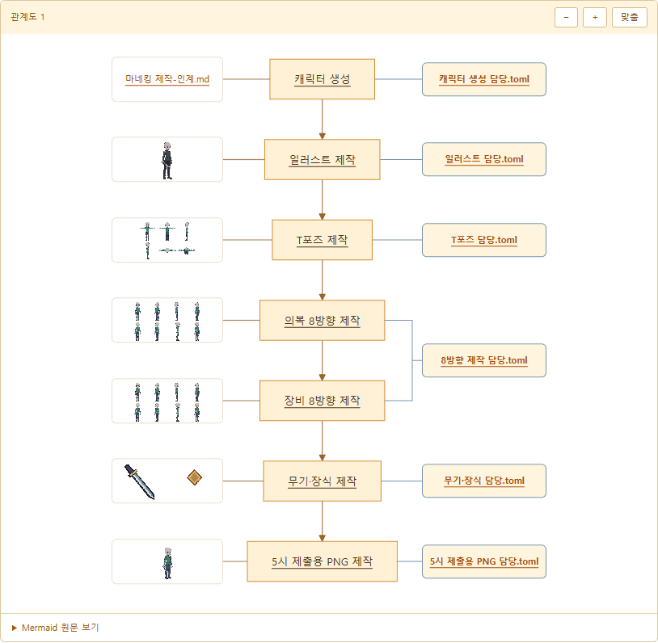

## 작업 결과

제작 다이어그램에 새 작업명 7개가 표시됩니다.

## 변경 내용

### 적용 내용

가운데 제작 노드 라벨을 변경했습니다.

## 검증

Chrome에서 새 노드 7개와 담당 카드 6개를 확인하고 T포즈 문서 팝업을 열었습니다. 프로젝트 커밋 54d800d7.

## 남은 사항

공개 페이지 반영은 미확인입니다.

## 작업 시간

- 제안 시간: 2026-11-21 15:03:42 KST 시작, 약 3분 예상.
- 실제로 완료된 시간: 생성 HTML 저장 재처리, 브라우저 검수와 프로젝트 푸시를 15:09:57 KST에 완료했습니다. 약 6분 15초 소요.
- XERJ: 미사용 — 웹 문서 생성과 Chrome 화면을 확인했습니다. 중앙 지침 2026-11-21-011 원격 확인.
