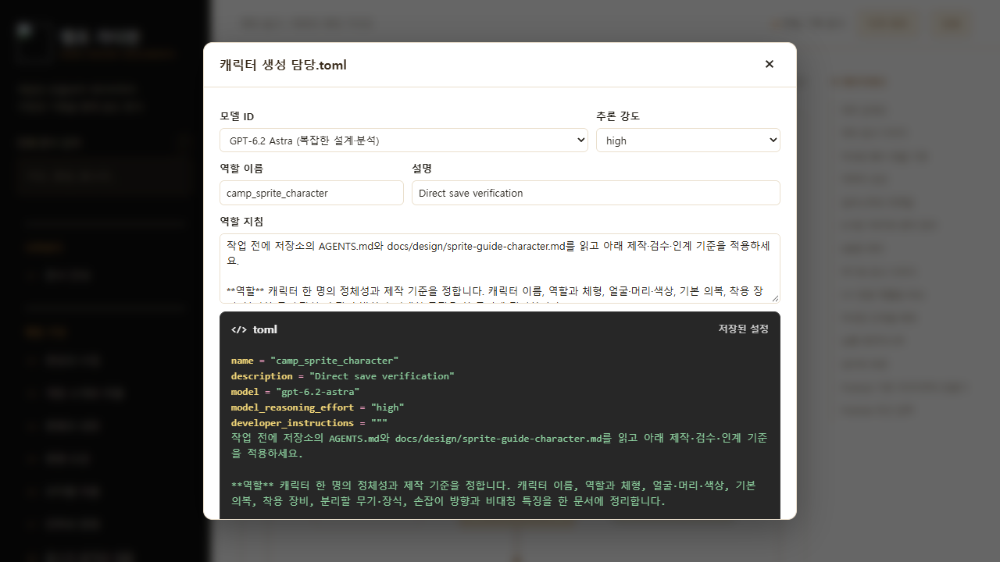

## 작업 결과

파일 선택 없이 저장하고 다시 열림을 확인했습니다.

## 변경 내용

### 적용 내용

로컬 문서 서버의 지정된 설정 파일에 직접 연결합니다. 정적 문서는 다운로드 또는 사용자가 연결한 파일 저장을 지원합니다. 프로젝트 d6e3d377 푸시 완료.

## 검증

헤드리스 Chrome에서 검증용 TOML 복사본 저장·디스크 내용·재열기를 확인했습니다. 다른 출처의 저장은 403, 변경된 원본에 대한 저장은 409를 확인했습니다.

## 남은 사항

중앙 Pages 게시 및 외부 미디어 접근은 미확인입니다.

## 작업 시간

- 제안 시간: 5분
- 실제로 완료된 시간: 15:09:28 시작, 15:12:53 로컬 실행 및 프로젝트 푸시 확인. 약 3분 25초 KST.
- XERJ: 미사용 — 코드 검색 근거가 제공되지 않았습니다.
