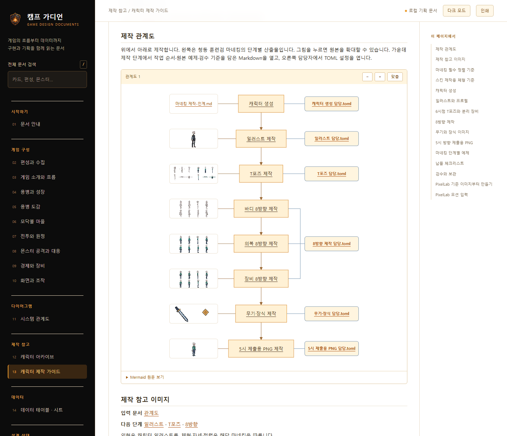

## 작업 결과

제작 다이어그램, 단계 문서, 두 전용 에이전트의 지침에서 바디 제작과 겹침 검수를 확인할 수 있습니다.

## 변경 내용

### 적용 내용

정면·후면·측면에서 가슴·허리·엉덩이·팔·허벅지 윤곽을 검수하고 캐릭터 고유의 볼륨을 고정합니다. 기존 남녀 기술 마네킹 원본을 예제로 연결했습니다.

## 검증

Chrome에서 관계도 노드 8개, 8방향 세 노드에 연결된 한 담당자, T포즈와 8방향의 남녀 기술 마네킹 PNG를 확인했습니다. T포즈 1536×1024, 8방향 2048×1024. 에이전트 TOML 두 개를 파싱했습니다. 프로젝트 커밋 1b993979.

## 남은 사항

특정 캐릭터의 새 바디 제작과 공개 페이지 반영은 미확인입니다.

## 작업 시간

- 제안 시간: 2026-11-21 15:10:59 KST 시작, 약 6분 예상.
- 실제로 완료된 시간: 브라우저 검수와 프로젝트 푸시를 15:13:32 KST에 완료했습니다. 약 2분 30초 소요.
- XERJ: 미사용 — 기존 기술 마네킹 원본과 Chrome의 가이드 화면을 확인했습니다. 중앙 지침 2026-11-21-011 원격 확인.
