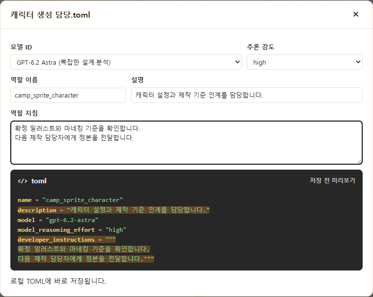

## 작업 결과

## 변경 내용

### 적용 내용

편집기 입력과 원본을 비교해 변경된 TOML 항목의 키와 값에 배경색을 표시합니다. 프로젝트 0da5bc0e 푸시 완료.

## 검증

로컬 문서를 Chrome에서 열어 설명과 여러 줄 역할 지침의 강조 및 값 복원 시 강조 해제를 확인했습니다. 화면 캡처의 입력값은 검증용입니다.

## 남은 사항

중앙 보고서 웹 게시 상태 미확인.

## 작업 시간

- 제안 시간: 4분
- 실제로 완료된 시간: 15:13:55 시작, 15:14:49 검증 및 프로젝트 푸시 완료. 54초 KST.
- XERJ: 미사용 — 코드 검색 근거가 제공되지 않았습니다.
