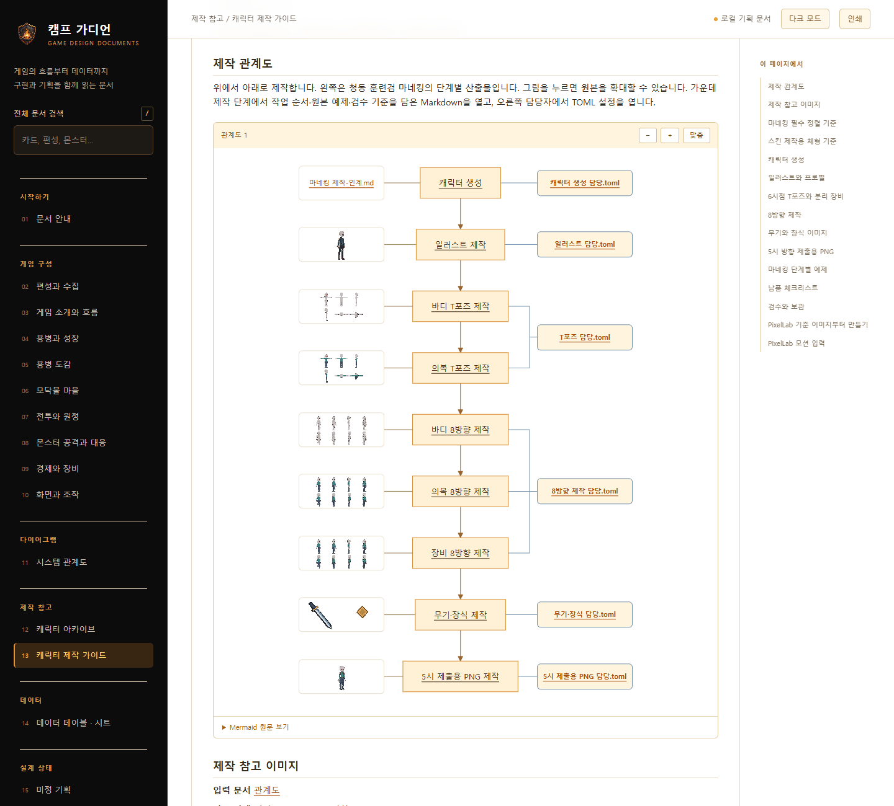

## 작업 결과

두 노드에서 같은 T포즈 가이드의 서로 다른 절과 실제 예제가 열립니다.

## 변경 내용

### 적용 내용

바디 T포즈를 의복 T포즈보다 앞에 배치하고, 의복은 검수된 바디를 복제해 제작하도록 문서화했습니다.

## 검증

Chrome에서 제작 노드 9개, 두 T포즈 노드가 공용 담당/개별 문서 절로 연결되는 것을 확인했습니다. 프로젝트 커밋 78c90178.

## 남은 사항

공개 페이지 반영은 미확인입니다. 기존 예제 원본을 사용했습니다.

## 작업 시간

- 제안 시간: 2026-11-21 15:14:59 KST 시작, 약 3분 예상.
- 실제로 완료된 시간: 로컬 검수와 프로젝트 푸시 15:16:06 KST 완료, 약 1분 소요.
- XERJ: 미사용 — 웹 문서 빌드와 Chrome으로 확인했습니다. 중앙 지침 2026-11-21-011 원격 확인.
