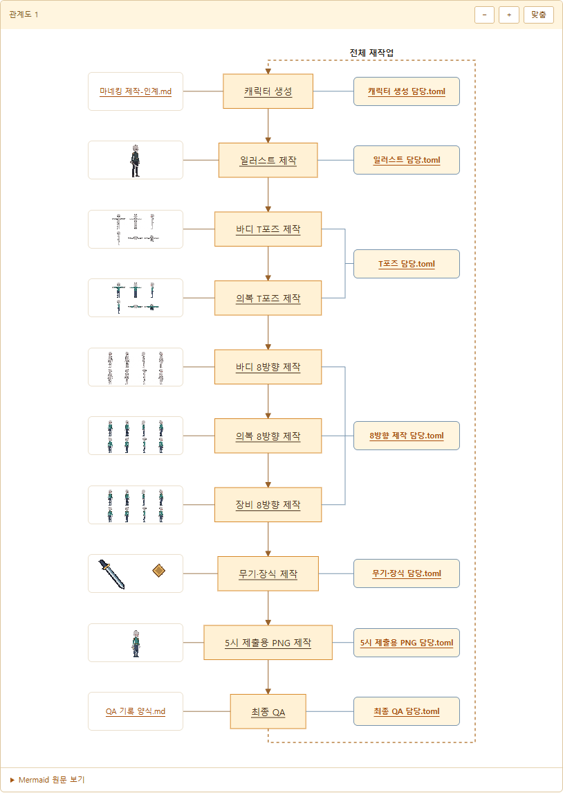
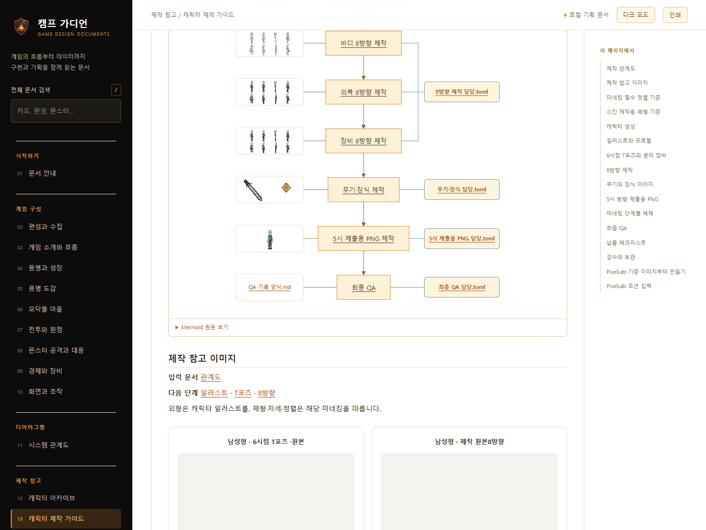

## 작업 결과

최종 QA 노드, 검수 기록 양식, 전용 TOML, 전체·부분 재작업과 최대 5회 재검수 규칙을 연결했습니다.

## 변경 내용

### 적용 내용

최종 QA가 시점별 마네킹 윤곽과 겹침, 기준·해시 및 합성 결과를 검토합니다. 전반 오류는 전체 재작업, 국소 오류는 해당 에이전트에게 반려합니다. 최초 QA 이후 재작업과 재검수는 최대 5회입니다.

## 검증

Chrome에서 제작 노드 10개와 전진 화살표 9개가 직선으로 정렬됐으며, 바깥쪽 점선이 최초 노드로 연결되는 것을 확인했습니다. QA 기준, 양식 및 등록 TOML 팝업을 확인했습니다. 프로젝트 커밋 285cbe78 및 d3415997.

## 남은 사항

실제 캐릭터에 대해 재작업·재검수 반복을 실행하는 검증과 공개 페이지 반영은 미확인입니다.

## 작업 시간

- 제안 시간: 2026-11-21 15:17:45 KST 시작, 약 5분 예상. 다이어그램 점선 요청 15:21:02 KST 시작, 약 3분 예상.
- 실제로 완료된 시간: 로컬 브라우저 검수 및 마지막 프로젝트 푸시 15:22:39 KST 완료. 전체 약 5분, 점선 약 2분 소요.
- XERJ: 미사용 — 웹 문서 빌드, Chrome, TOML 파싱으로 확인했습니다. 중앙 지침 2026-11-21-011 원격 확인.
