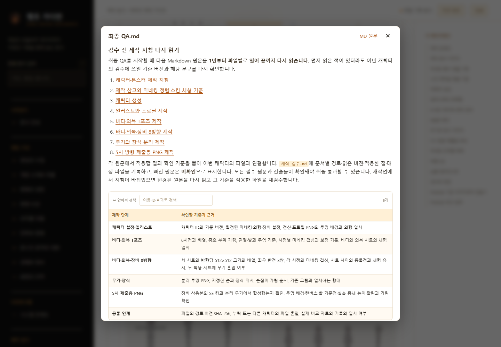
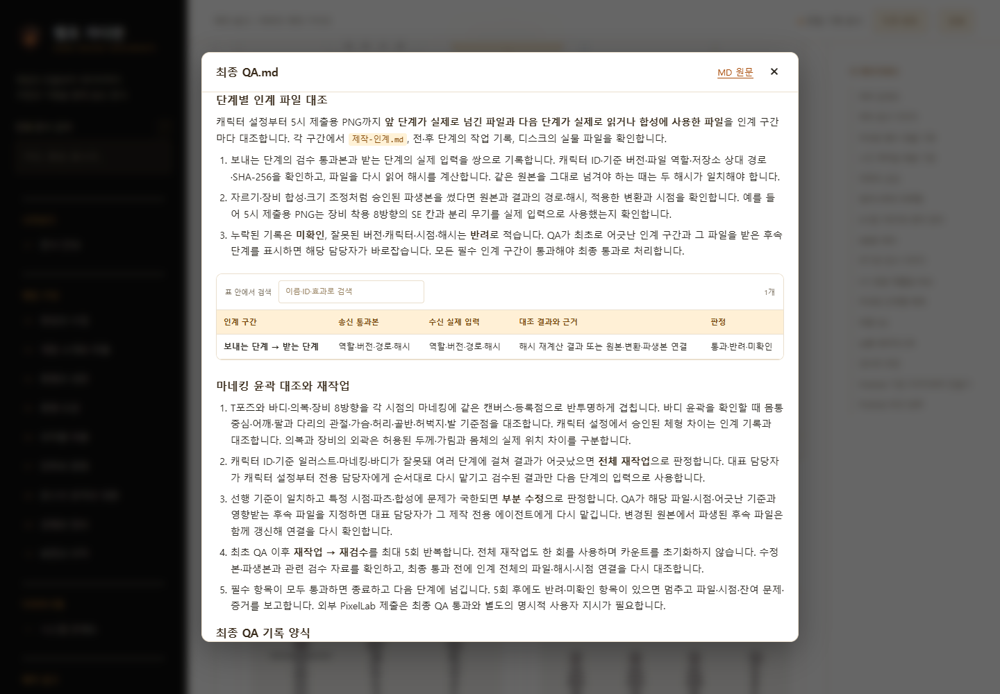

## 작업 결과

QA 담당 TOML, 제작 인계 기준, 웹 QA 문서에 원문 및 파일 비교를 반영했습니다.

## 변경 내용

### 적용 내용

검수 전에 원문 8건을 순서대로 다시 읽습니다. 각 인계 구간은 역할·버전·경로·재계산한 SHA-256을 비교하고 파생본은 변환 근거를 추적합니다.

## 검증

Chrome에서 제작 원문 링크 8개가 실제 파일에 연결되고 인계 대조 표가 표시되며 최종 QA TOML이 실제 원문과 일치함을 확인했습니다. 프로젝트 커밋 0af77b89, 01217f13.

## 남은 사항

실제 캐릭터 전 제작 단계의 인계 파일을 QA 에이전트로 검수하는 작업과 공개 페이지 반영은 미확인입니다.

## 작업 시간

- 제안 시간: 2026-11-21 15:26:04 KST 시작, 약 3분 예상. 인계 파일 대조 요청 15:27 KST 확인.
- 실제로 완료된 시간: 로컬 브라우저 검수와 최종 프로젝트 푸시 15:28:54 KST 완료. 약 3분 소요.
- XERJ: 미사용 — 웹 문서 빌드, Chrome과 로컬 파일 경로 확인. 중앙 지침 2026-11-21-011 원격 확인.
