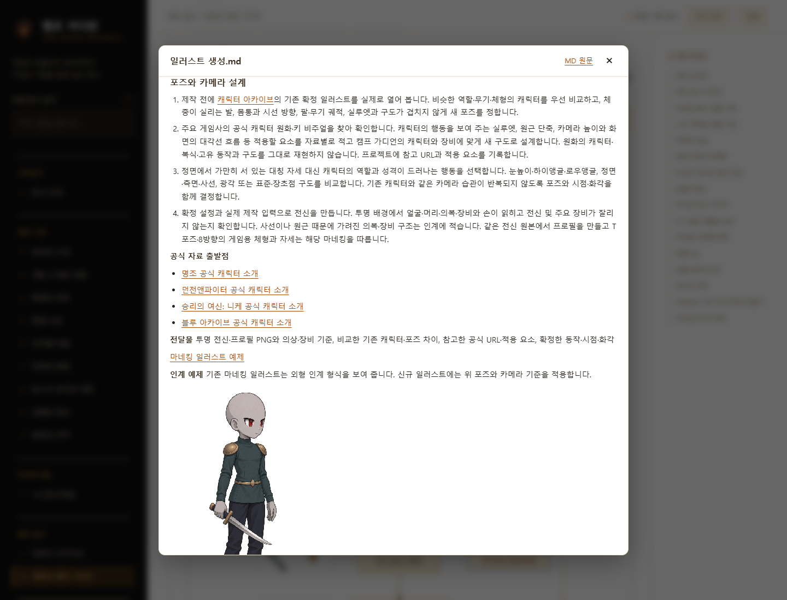

## 작업 결과

일러스트 제작 안내, 전용 TOML, 공통 제작 지침과 QA 기준에 반영했습니다.

## 변경 내용

### 적용 내용

기존 아카이브의 포즈와 실루엣을 비교하고 공식 원화에서 가져올 연출 요소를 명시합니다. 성격과 역할을 드러내는 행동 및 카메라를 설계하고 참고 URL과 적용 근거를 인계합니다.

## 검증

Chrome에서 일러스트 지침, 네 곳의 공식 참고 링크, 실제 에이전트 TOML과 QA 기준을 확인했습니다. 프로젝트 커밋 4ab10e63.

## 남은 사항

새 지침을 적용해 특정 캐릭터의 일러스트를 제작하는 작업과 공개 페이지 반영은 미확인입니다.

## 작업 시간

- 제안 시간: 2026-11-21 15:30:11 KST 시작, 약 4분 예상.
- 실제로 완료된 시간: 브라우저 검수 및 프로젝트 푸시 15:31:52 KST 완료, 약 1분 40초 소요.
- XERJ: 미사용 — 공식 게임 출처, 웹 문서 빌드, Chrome을 사용했습니다. 중앙 지침 2026-11-21-011 원격 확인.
