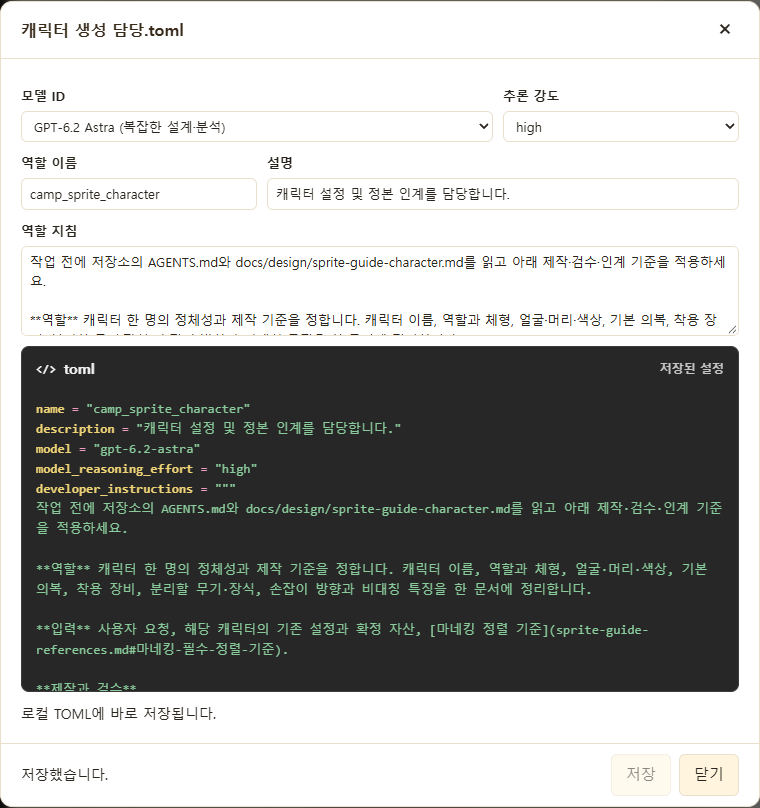

## 작업 결과

## 변경 내용

### 적용 내용

하단 작업 버튼과 저장 상태를 추가했습니다. 저장 후 변경 강조를 초기화합니다. 프로젝트 690f17f4 푸시 완료.

## 검증

Chrome에서 검증용 TOML 복사본을 사용해 저장 후 창 유지, 닫기에서 저장 후 창 닫힘, 두 동작의 디스크 파일 반영을 확인했습니다.

## 남은 사항

중앙 보고서 웹 게시 미확인.

## 작업 시간

- 제안 시간: 4분
- 실제로 완료된 시간: 15:37:27 시작, 15:38:40 검증 및 프로젝트 푸시 완료. 1분 13초 KST.
- XERJ: 미사용 — 코드 검색 근거가 제공되지 않았습니다.
