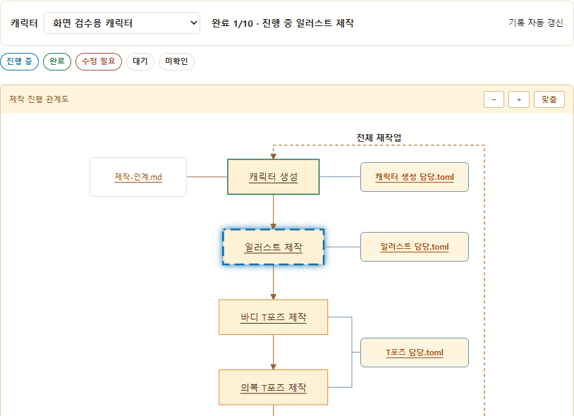
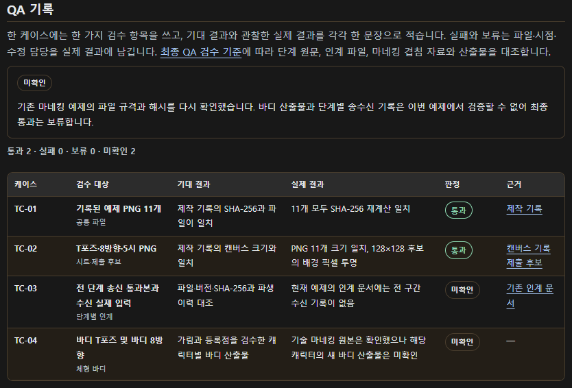

## 작업 결과

프로젝트 main에 6c1fe9c3을 푸시했습니다. 제작자가 기록을 갱신하면 열려 있는 게시판에 반영됩니다. 마네킹 예제의 파일 검사 2건은 통과했고, 개별 바디 산출물과 인계 대조 2건은 미확인으로 표시했습니다.

## 변경 내용

### 적용 내용

- 현재 단계는 빛나는 테두리, 완료 단계는 옆 미리보기로 표시합니다.
- QA 표에 케이스 ID, 대상, 기대·실제 결과, 판정, 근거를 제공합니다.
- 실제 로컬 화면에 검수용 캐릭터 상태를 넣어 캡처한 GIF입니다.

## 검증

실제 Chrome 로컬 서버 화면에서 단계 기록 CLI 갱신 → 4초 폴링 → 진행 중 테두리 이동 → 완료 이미지 로딩 → QA 수정 필요 표시를 확인했습니다. 모션 감소 설정, 이미지 확대 모달 및 QA 케이스 4건 표시도 확인했습니다. GIF 8프레임 중 연속 7쌍의 변화가 확인됐습니다.

## 남은 사항

마네킹 예제의 두 미확인 항목은 실제 캐릭터의 바디 파일과 단계별 송수신 기록이 등록된 뒤 검수합니다. 공개 페이지 배포 및 미디어 접근은 별도 확인입니다.

## 작업 시간

- 제안 시간: 8~10분
- 실제로 완료된 시간: 2026-11-21 15:36:39~15:44:52 KST, 약 8분 13초
- XERJ: 미사용 — 로컬 소스, 기록 CLI, Chrome 및 Git으로 확인했습니다.
