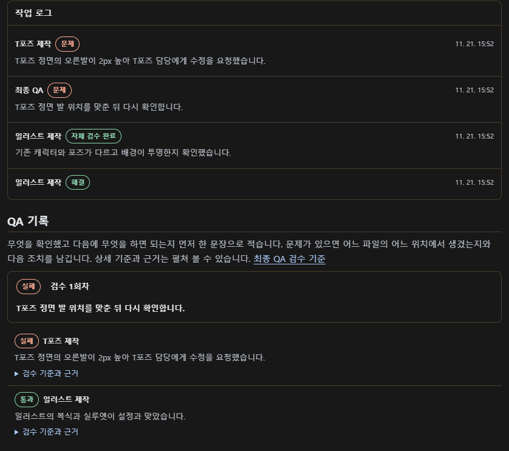

## 작업 결과

QA 결과는 실제 관찰과 다음 조치가 먼저 나옵니다. 문제나 해결 기록에는 해당 단계와 시각이 표시됩니다. 담당자 자체 검수 기록과 산출물이 있어야 단계를 완료할 수 있습니다.

## 변경 내용

### 적용 내용

기존 TC 기준과 근거 링크는 QA 항목에서 펼쳐 볼 수 있습니다. 제작 에이전트 6개의 TOML과 최종 QA 에이전트 TOML 및 프로젝트 지침에 검수와 기록 절차를 반영했습니다.

## 검증

Chrome 로컬 서버에서 자체 검수 없이 완료하면 거부되는 동작, 자체 검수 등록, 단계별 문제와 해결 기록, 최종 QA에서 확인한 문제가 해당 제작 단계에 표시되는 동작, 근거 펼치기, 자동 갱신을 확인했습니다. TOML 7개를 파싱했습니다. 프로젝트 main에 6aa8c12d를 푸시했습니다.

## 남은 사항

공개 페이지 배포와 실제 후속 캐릭터 제작에서 에이전트가 지침을 이행하는지는 미확인입니다.

## 작업 시간

- 제안 시간: 8~10분
- 실제로 완료된 시간: 2026-11-21 15:49:02~15:52:52 KST, 약 3분 50초
- XERJ: 미사용 — 로컬 CLI, Chrome 및 TOML 구문 검사로 확인했습니다.
