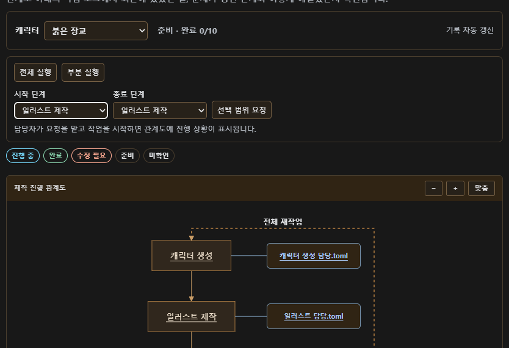

## 작업 결과

전체 실행과 부분 실행의 범위를 로컬 요청함에 저장합니다. 시작과 종료가 같으면 한 단계만 요청합니다. 담당자가 시작하기 전까지 준비 또는 기존 상태가 유지됩니다.

## 변경 내용

### 적용 내용

캐릭터를 용병, 몬스터, 마을 NPC, 마을 주민, 보스로 묶었습니다. 요청을 Codex에 전달할 때 사용할 문구를 복사할 수 있습니다.

## 검증

격리한 로컬 사본의 Chrome에서 65종과 제작 예제 1종, 준비 상태, 한 단계 접수, 범위 접수, 완료 후 재요청, 전체 10단계 접수, 중복 거절, 요청 문구 복사, 담당자 인수, 새로운 자체 검수 없이 완료할 수 없는 동작을 확인했습니다. 프로젝트 main에 bc56fbe9를 푸시했습니다.

## 남은 사항

실제 캐릭터 제작은 진행하지 않았습니다. 접수된 요청은 담당자가 맡아서 실행합니다. 공개 보고서 배포와 공개 미디어 접근은 미확인입니다.

## 작업 시간

- 제안 시간: 8~10분
- 실제로 완료된 시간: 2026-11-21 15:53:42~15:57:44 KST, 약 4분
- XERJ: 미사용 — 로컬 서버, Chrome, 프로젝트 CLI 및 Git으로 확인했습니다.
