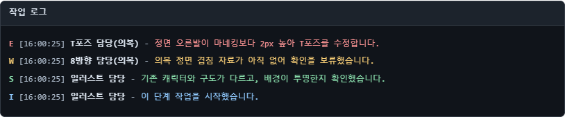

## 작업 결과

작업 로그에 어두운 배경과 고정폭 글꼴을 적용했습니다. 오류는 빨강, 경고는 노랑, 정보는 파랑, 자체 검수 완료와 해결은 초록으로 표시합니다.

## 변경 내용

### 적용 내용

단계에 맞춰 담당자를 표시하고, 바디·의복·장비 단계 이름을 담당자 옆에서 확인할 수 있습니다. 단계별 기록 명령에서 경고 유형을 사용할 수 있습니다.

## 검증

Chrome에서 임시 검수용 기록 네 건의 E/W/I/S 문자와 색상, [시:분:초], 담당자, 하이픈, 메시지를 확인했습니다. 390px 뷰포트에서 가로 넘침이 없었습니다. 프로젝트 main에 7845e020을 푸시했습니다.

## 남은 사항

공개 보고서 배포와 공개 미디어 접근은 미확인입니다.

## 작업 시간

- 제안 시간: 5~7분
- 실제로 완료된 시간: 2026-11-21 15:58:45~16:00:48 KST, 약 2분
- XERJ: 미사용 — 로컬 기록 CLI, Chrome 및 Git으로 확인했습니다.
